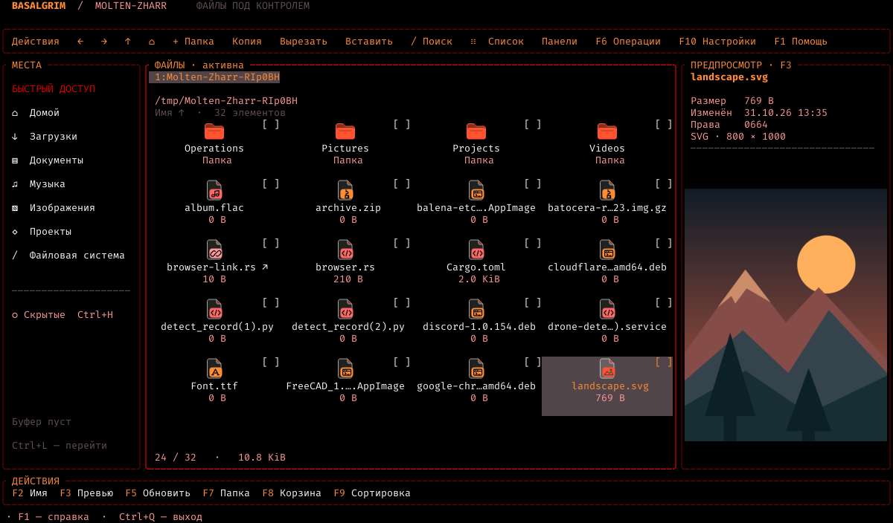

# Basalgrim

Файловый менеджер для Linux из Molten-Zharr. Помогает просматривать папки и работать с файлами в окне или терминале, мышью и клавиатурой.

[English](README.en.md) · [Русский](README.md)

  
  
  
  

[Документация](docs/USAGE.md)
