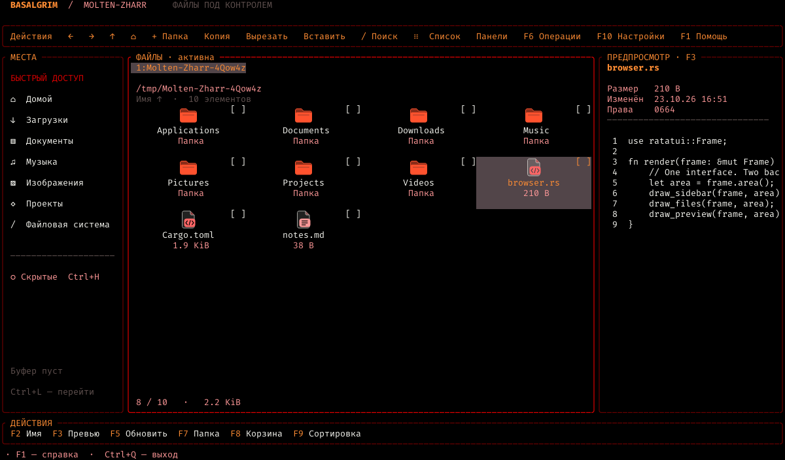
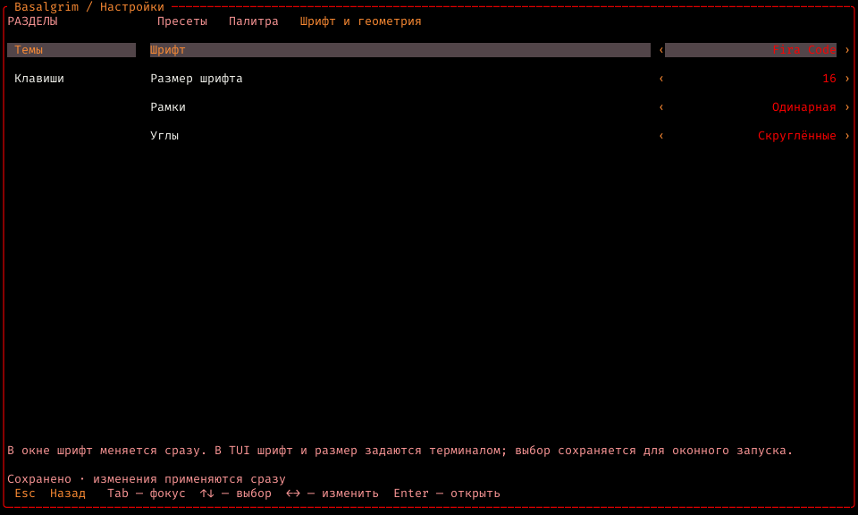

# Basalgrim

Файловый менеджер **Molten-Zharr**. Первый рабочий срез для Linux на Rust, Ratatui и egui.

Как в [Almavorn](https://github.com/Molten-Zharr/Almavorn), состояние приложения, действия, раскладка и отрисовка общие для двух вариантов запуска: терминального TUI и оконного GUITUI. Компоновка вдохновлена [tfm-tui](https://github.com/clarkarch/tfm-tui): места слева, файлы в центре, предпросмотр справа. Код tfm-tui не используется.

Фирменная палитра взята из локального Almavorn: чёрный фон, красные рамки, оранжевое выделение, Fira Code. JSON в [assets/brand/molten-zharr.json](assets/brand/molten-zharr.json) определяет общие роли цветов и исходную палитру Molten-Zharr. Дополнительные темы и настройки оформления адаптированы из Almavorn; пользовательские цвета хранятся в настройках. Встроенные SVG-иконки папок и типов файлов окрашиваются текущей палитрой. В терминале без графического протокола используются символы; Nerd Font не требуется.



## Запуск

Проверено с Rust 1.99.0 на Linux. GUITUI требует графическую сессию Wayland/X11 и OpenGL. Терминальная сборка не включает egui, eframe и растеризацию шрифтов.

```sh
# Оконное приложение; путь необязателен, по умолчанию текущая папка
cargo run --release -- /путь/к/папке

# Только терминал
cargo run --release --no-default-features --features tui --bin basalgrim-tui -- /путь/к/папке
```

`gio` нужен для системной корзины, `xdg-open` — для открытия файлов внешними приложениями. В Debian/Ubuntu: `sudo apt install libglib2.0-bin xdg-utils`. Без этих программ просмотр каталогов и остальные операции работают; соответствующее действие покажет ошибку.

## Что уже работает

- Места, переход по пути с `~`, история назад/вперёд, вкладки и две независимые панели.
- Сетка и список, сортировка по имени/размеру/дате, скрытые файлы, фильтр текущей папки.
- Графические иконки в сетке и списке: папки, документы, код, архивы, изображения, аудио, видео, PDF, приложения, шрифты и ссылки. В TUI автоматически проверяются Kitty/Sixel; для совместимых терминалов поддерживается iTerm2. Без графики используется символьный вариант. В настройках можно предпочесть символы и при доступной графике.
- Текстовый предпросмотр, информация о файле, содержимое папки и ссылки. Чтение ограничено 64 KiB / 300 строками; специальные файлы не читаются.
- Клавиатура, щелчок, двойной щелчок, Ctrl+щелчок и колесо мыши в обоих интерфейсах.
- Лёгкая подсветка при наведении на файлы, папки, кнопки, вкладки и элементы настроек. Она не меняет выбор и не запускает команды; выбранный элемент сохраняет основное выделение. В TUI используются события движения мыши от терминала.
- Множественный выбор, внутренний буфер копирования/вырезания, вставка, создание файлов/папок, переименование.
- Отправка в системную корзину после подтверждения. Восстановление — через корзину рабочего стола.
- Общие настройки вида в `$XDG_CONFIG_HOME/molten-zharr/basalgrim/settings.json` (обычно `~/.config/…`), атомарное сохранение. Повреждённый файл настроек сохраняется, приложение использует значения по умолчанию без записи поверх него.
- Экран настроек GUI/TUI: четыре темы, редактирование палитры, три шрифта, размер и геометрия рамок; переназначение клавиш с проверкой конфликтов.

## Управление

| Клавиши | Действие |
| --- | --- |
| Стрелки, Home/End, PageUp/PageDown | Навигация |
| Enter / двойной щелчок | Открыть |
| Backspace / Alt+↑ | Родительская папка |
| Alt+← / Alt+→ | История |
| Alt+Home / Ctrl+L | Домой / ввод пути |
| `/` / Ctrl+F | Фильтр текущей папки |
| Ctrl+G / Ctrl+D / Tab | Сетка–список / две панели / смена панели |
| Ctrl+T / Ctrl+W / Ctrl+Tab | Новая / закрыть / следующая вкладка |
| Space / Ctrl+A / Esc | Отметить / выбрать все видимые / сбросить выбор и фильтр |
| Ctrl+C / Ctrl+X / Ctrl+V | Копировать / вырезать / вставить |
| F2 | Переименовать |
| Ctrl+Shift+N или F7 / Ctrl+N | Новая папка / новый файл |
| Delete или F8 | В корзину |
| F3 / F5 / F9 | Предпросмотр / обновить / сортировка |
| Ctrl+H | Скрытые файлы |
| Ctrl+`+` / Ctrl+`−` | Размер шрифта GUITUI |
| F1 / Ctrl+Q | Справка / выход |
| F10 / Ctrl+, | Настройки |
| Ctrl+U в поле ввода | Очистить поле |

Фильтр обновляется при вводе; Enter сохраняет его, Esc возвращает предыдущее значение. Текст редактируется в конце строки. В терминалах сочетания с Ctrl+Shift и Ctrl+Tab могут не передаваться; F7 доступна для создания папки, вкладку можно выбрать мышью. Размер шрифта TUI задаёт терминал.

## Настройки

Откройте **Настройки** на панели команд, нажмите `F10` или `Ctrl+,`. Экран устроен как в Almavorn: разделы слева, параметры справа, описание выбранного пункта и состояние сохранения снизу. Мышь и клавиатура работают в обоих вариантах запуска.

- `Tab` / `Shift+Tab` переключают фокус между разделами, вкладками темы и параметрами. `↑`/`↓`, Home/End и PageUp/PageDown перемещают выбор; `←`/`→` меняют значение; Enter открывает редактор или выполняет действие; Esc возвращает назад.
- **Темы → Пресеты**: Molten-Zharr, Classic Amber, Classic Violet и Light. Выбор темы меняет палитру, сохраняя выбранные шрифт и геометрию. **Сбросить оформление** возвращает исходное оформление целиком.
- **Темы → Палитра**: нажмите на HEX-значение или Enter, введите `#RRGGBB`; `Ctrl+U` очищает поле. Изменения цветов сохраняются отдельно для каждой темы. Сброс цветов затрагивает только текущую тему.
- **Темы → Шрифт и геометрия**: Fira Code, Fira Code Bold, DejaVu Sans Mono; размер 10–32; рамки без обводки, одинарные, двойные или толстые; прямые/скруглённые углы одинарной рамки. Шрифт в окне меняется сразу, с учётом масштаба экрана. В TUI эти параметры сохраняются для оконного запуска; шрифт самого терминала контролирует терминал.
- **Темы → Иконки**: **Изображения** или **Символы**, переключение стрелками, Enter или мышью. Выбор применяется сразу и сохраняется. Если терминал не поддерживает изображения, приложение показывает символы и сохраняет предпочтение для GUI или другого терминала. Изображения в окне масштабируются под размер шрифта и DPI; наведение и выделение сохраняют свой фон.
- **Клавиши**: выберите команду и Enter, затем нажмите новое сочетание либо выберите модификаторы и клавишу мышью. Колесо прокручивает список клавиш. Esc отменяет захват. Delete на строке команды возвращает исходное сочетание, первая строка восстанавливает все назначения.

Сочетания проверяются на точное совпадение модификаторов и конфликты. Стрелки, Home/End, PageUp/PageDown и Esc зарезервированы для навигации; Enter, Tab, Space и Backspace доступны для своих действий. `Ctrl+U` сохраняет значение очистки поля ввода. В диалоге захвата нажатия не запускают команды приложения. Подсказки в справке и панели действий обновляются после переназначения. Таблица выше показывает исходные назначения.

Настройки применяются сразу и сохраняются автоматически. Старый JSON, в том числе прежний `font_size`, загружается с исходными значениями новых полей. Ошибка записи отображается внизу экрана, изменения остаются в памяти; `Ctrl+S` или щелчок на сообщении повторяет сохранение. Если исходный файл повреждён или содержит конфликтующие сочетания, он сохраняется без перезаписи, а автосохранение отключается для этого запуска.



## Файловые операции

Существующая цель, включая сломанную символическую ссылку, вызывает ошибку. На Linux переименование и перемещение используют атомарный `RENAME_NOREPLACE`. Копирование сначала создаёт временное дерево в целевой файловой системе и публикует готовый элемент через то же переименование. При ошибке до публикации временное дерево удаляется. Символические ссылки копируются как ссылки; специальные файлы отклоняются.

Каждый элемент пакета выполняется отдельно. При первой ошибке пакет останавливается, интерфейс сообщает число завершённых элементов и причину. Уже завершённые элементы остаются; неудавшиеся элементы вырезания сохраняются в буфере. Автоматического отката пакета пока нет. Это предотвращает скрытое повторное перемещение уже завершённых элементов.

Перемещение пока работает **в пределах одной файловой системы**. Между файловыми системами можно копировать, затем отдельно отправлять оригиналы в корзину. Копирование сохраняет обычные права доступа, но пока не переносит timestamps, ACL, xattrs и структуру жёстких ссылок. Снимок одновременно изменяемого дерева не гарантируется. Выход через интерфейс блокируется до завершения файловой операции.

## Устройство проекта

| Файл | Ответственность |
| --- | --- |
| `src/app.rs`, `src/app/` | Общие действия, навигация, диалоги, обработка ввода и результатов |
| `src/model.rs` | Панели, вкладки, выбор, фильтр и история |
| `src/worker.rs` | Три фоновых исполнителя: каталоги, предпросмотр, операции |
| `src/fs.rs` | Чтение, предпросмотр и файловые операции |
| `src/ui.rs`, `src/ui/` | Общая отрисовка Ratatui и области щелчков |
| `src/main.rs`, `src/raster.rs` | egui/eframe, egui_ratatui, Fira Code и ввод GUITUI |
| `src/icons.rs`, `src/icons/`, `assets/icons/` | Типы и области иконок, SVG-растеризация, проверка терминала и фоновое кодирование графики |
| `src/bin/tui.rs` | Crossterm, мышь, вставка текста, восстановление терминала |
| `src/settings.rs` | JSON-настройки с serde defaults и атомарным сохранением |
| `src/preferences.rs`, `src/app/settings.rs`, `src/ui/settings.rs` | Палитры и шрифты, управление экраном настроек и его общий рендер |

Результаты чтения каталогов проверяются по идентификатору запроса вкладки. Предпросмотр использует отдельную очередь с выбором последнего запроса. Длительные операции не исполняются в потоке интерфейса. Состояние выделения и данные файлов используют `PathBuf`, отображаемые имена очищаются от управляющих символов.

## Проверка и изображения интерфейса

```sh
cargo fmt --check
cargo clippy --all-features --all-targets -- -D warnings
cargo test --all-features --all-targets
cargo test --no-default-features --features tui --all-targets
cargo run --example preview

# Проверка настоящего TUI в PTY с отдельной корзиной и настройками
cargo build --no-default-features --features tui --bin basalgrim-tui
python3 scripts/smoke_tui.py
python3 scripts/smoke_icons.py
```

`cargo run --example preview` создаёт PPM-снимки реального рендера в `target/preview/`: сетка, список, две панели, компактный интерфейс, справка, светлая тема и страницы настроек. Графическая сессия для неё не нужна. Демонстрационные файлы создаются во временной папке. PTY-проверка дополнительно проверяет редактор шрифта, тему, захват сочетаний и восстановление настроек после перезапуска.

`smoke_icons.py` эмулирует ответы терминалов Kitty/Sixel/iTerm2 и терминал без графики, включая отсутствие любых ответов. Проверяет вывод изображений или символов, переключение и сохранение режима, изменение размеров, последующий ввод и восстановление терминала. Подготовка и кодирование терминальных изображений выполняются в отдельном потоке с проверкой идентификатора запроса и поколения кэша. Проверка возможностей ограничена 500 мс и завершается до запуска обработчика ввода; настройки терминала или tmux автоматически не меняются.

## Следующие этапы

Это основа приложения; функциональный паритет с tfm-tui ещё не достигнут. План продолжения — [docs/ROADMAP.md](docs/ROADMAP.md): прогресс и отмена операций, перемещение между файловыми системами, журнал undo/redo, изображения, контекстные меню и встроенный терминал.
