# Руководство Basalgrim

## Запуск

Проверено с Rust 1.99.0 на Linux. GUITUI требует графическую сессию Wayland/X11 и OpenGL. Терминальная сборка не включает egui, eframe и растеризацию шрифтов.

```sh
# Оконное приложение; явный путь открывает новую сессию
cargo run --release -- /путь/к/папке

# Только терминал
cargo run --release --no-default-features --features tui --bin basalgrim-tui -- /путь/к/папке
```

`gio` нужен для системной корзины, `xdg-open` — для открытия файлов внешними приложениями. В Debian/Ubuntu: `sudo apt install libglib2.0-bin xdg-utils`. Без этих программ просмотр каталогов и остальные операции работают; соответствующее действие покажет ошибку.

Без пути приложение восстанавливает последнюю сессию. Если её ещё нет, открывает текущую папку. `--no-session` запускает приложение без чтения и сохранения сессии; этот параметр доступен в обоих режимах.

## Что уже работает

- Места, переход по пути с `~`, история назад/вперёд, вкладки и две независимые панели.
- Восстановление каталогов, порядка вкладок, активных вкладок и панели между запусками GUI и TUI.
- Постоянный журнал файловых операций в SQLite: история после перезапуска, отмена и повтор завершённых операций, фактические пути и результаты.
- Сетка и список, сортировка по имени/размеру/дате, скрытые файлы, фильтр текущей папки.
- Графические иконки в сетке и списке: папки, документы, код, архивы, изображения, аудио, видео, PDF, приложения, шрифты и ссылки. В TUI автоматически проверяются Kitty/Sixel; для совместимых терминалов поддерживается iTerm2. Без графики используется символьный вариант. В настройках можно предпочесть символы и при доступной графике.
- Текстовый предпросмотр с подсветкой кода, информация о файле, содержимое папки и ссылки. Чтение ограничено 64 KiB / 300 строками; специальные файлы не читаются.
- Изображения в панели предпросмотра (F3): PNG, JPEG, GIF, WebP, BMP, TIFF, ICO и SVG. В GUI и терминалах Kitty/Sixel/iTerm2 картинка вписывается в панель с сохранением пропорций; прозрачность смешивается с фоном темы, учитывается EXIF-ориентация. Показывается первый кадр/страница. Без графики остаются сведения о файле. Выбор символьных **иконок** не отключает предпросмотр изображений.
- Клавиатура, щелчок, двойной щелчок, Ctrl+щелчок, выделение рамкой и колесо мыши в обоих интерфейсах. Правый щелчок открывает меню команд; кнопка «Действия» доступна и в узком окне. Отметки рядом с файлами позволяют выбрать несколько элементов мышью.
- Лёгкая подсветка при наведении на файлы, папки, кнопки, вкладки и элементы настроек. Она не меняет выбор и не запускает команды; выбранный элемент сохраняет основное выделение. В TUI используются события движения мыши от терминала.
- Колесо прокручивает содержимое панели под указателем, сохраняя клавиатурный курсор, отмеченные файлы и предпросмотр. В двухпанельном режиме оно не переключает активную панель. Стрелки, Home/End и Page Up/Down снова показывают клавиатурный курсор; копирование продолжает работать с прежним выбором, даже если он ушёл за край экрана.
- Открытые каталоги обновляются при внешнем создании, изменении, переименовании и удалении файлов. Сохраняются выбор, фильтр, сортировка и положение просмотра; изменения текущего файла обновляют предпросмотр.
- Множественный выбор, системный файловый буфер копирования/вырезания с внутренним режимом для терминалов без поддержки; вставка, создание файлов/папок, переименование.
- Копирование и перемещение выбранных файлов в соседнюю панель, дублирование рядом с оригиналом со свободным именем.
- Совпадения имён при копировании, перемещении и переименовании: заменить, пропустить, сохранить оба или отменить; выбор можно применить к оставшимся конфликтам пакета.
- Системная корзина: отправка после подтверждения, просмотр удалённых элементов и восстановление из приложения.
- Общие настройки вида в `$XDG_CONFIG_HOME/molten-zharr/basalgrim/settings.json` (обычно `~/.config/…`), атомарное сохранение. Повреждённый файл настроек сохраняется, приложение использует значения по умолчанию без записи поверх него.
- Экран настроек GUI/TUI: четыре темы, редактирование палитры, три шрифта, размер и геометрия рамок; переназначение клавиш с проверкой конфликтов.

## Управление

| Клавиши | Действие |
| --- | --- |
| Стрелки, Home/End, PageUp/PageDown | Навигация |
| Shift + навигация / щелчок | Выделить диапазон файлов |
| Ctrl+Shift + навигация / щелчок | Добавить диапазон к выбранным файлам |
| Enter / двойной щелчок | Открыть |
| Backspace / Alt+↑ | Родительская папка |
| Alt+← / Alt+→ | История |
| Alt+Home / Ctrl+L | Домой / ввод пути |
| Ctrl+Shift+C | Копировать полный путь текущей папки |
| `/` / Ctrl+F | Фильтр текущей папки |
| Ctrl+G / Ctrl+D / Tab | Сетка–список / две панели / смена панели |
| Ctrl+T / Ctrl+W / Ctrl+Tab | Новая / закрыть / следующая вкладка |
| Space / Ctrl+A / Esc | Отметить / выбрать все видимые / сбросить выбор и фильтр |
| Ctrl+C / Ctrl+X / Ctrl+V | Копировать / вырезать / вставить |
| Shift+F5 / Shift+F6 | Копировать / переместить в соседнюю панель |
| Ctrl+F5 | Дублировать рядом с оригиналом |
| F2 | Переименовать |
| Ctrl+Shift+N или F7 / Ctrl+N | Новая папка / новый файл |
| Delete или F8 | В корзину |
| Ctrl+Shift+B | Открыть / закрыть просмотр корзины |
| Enter / Ctrl+Shift+R в корзине | Восстановить на исходное место |
| Ctrl+Alt+R в корзине | Восстановить в текущую папку |
| F4 | Открыть терминал / вернуть ему фокус / скрыть |
| F3 / F5 / F9 | Предпросмотр / обновить / сортировка |
| Shift+F4 | Подсчитать размер выбранной папки; без выбранной папки — текущей |
| F6 / Ctrl+F6 | Операции / отменить текущую операцию |
| Ctrl+Shift+F6 | Хранилище undo/redo |
| Ctrl+Z / Ctrl+Y | Отменить завершённую операцию / повторить отменённую |
| Ctrl+H | Скрытые файлы |
| Ctrl+`+` / Ctrl+`−` | Размер шрифта GUITUI |
| F1 / Ctrl+Q | Справка / выход |
| F10 / Ctrl+, | Настройки |
| Ctrl+U в поле ввода | Очистить поле |

Фильтр обновляется при вводе; Enter сохраняет его, Esc возвращает предыдущее значение. Поля поддерживают курсор, выделение и текстовый буфер. В терминалах сочетания с Ctrl+Shift и Ctrl+Tab могут не передаваться; F7 доступна для создания папки, вкладку можно выбрать мышью. Размер шрифта TUI задаёт терминал.

## Панели и вкладки

Кнопка **+ Вторая панель** в заголовке файловой области открывает соседнюю панель; **×** в заголовке второй панели скрывает её. Каталоги и вкладки сохраняются при закрытии и повторном открытии. Сочетание **Ctrl+D** делает то же самое.

**+** сразу после вкладок создаёт новую вкладку в той панели, где вы нажали кнопку, с её текущим каталогом. При нехватке места стрелки **‹ / ›** позволяют перейти к скрытым вкладкам. `Ctrl+T` создаёт вкладку активной панели, `Ctrl+W` закрывает её.

Нижняя строка начинается с **F1 Помощь**, затем идут **F2 Переименовать** и остальные команды, включая **F6 Операции** и **F10 Настройки**. В минимальном окне отображаются сами сочетания клавиш; мышь продолжает работать.

## Строка пути

Нажмите на родительскую папку в строке над файлами, чтобы перейти в неё. Переход сохраняется в истории. Щелчок по текущей папке открывает редактирование прямо в адресной строке. Кнопка **Коп.** копирует полный путь этой панели в текстовый буфер обмена, включая пробелы; выбранные для копирования или вырезания файлы остаются в файловом буфере.

Если путь не помещается, **…** открывает список родительских папок. В нём работают мышь, колесо, стрелки, Home/End и кнопки прокрутки. Этот же список открывается правым щелчком по строке пути. Esc или щелчок снаружи закрывает его.

Щелчок по текущей папке или `Ctrl+L` открывает ввод на месте пути с выделенным полным адресом. Начните печатать, чтобы заменить его; `Ctrl+A` выделяет поле, `Ctrl+C` копирует выделение, кнопка **Коп.** — весь введённый адрес. Стрелки и Home/End перемещают видимый курсор, щелчок внутри поля ставит его в место ввода, двойной щелчок выделяет весь путь. Backspace/Delete удаляют символы; составные и широкие символы учитываются при перемещении. Enter переходит по адресу, Esc закрывает ввод. Относительные пути разрешаются от текущей папки, `~` — от домашней.

Текст пути передаётся в системный буфер используемого бэкенда. Когда нативный буфер недоступен, TUI пробует `wl-copy`, `xclip` или `xsel` в фоне, затем [OSC 52](https://invisible-island.net/xterm/ctlseqs/ctlseqs.html). Терминал должен разрешать запись этим протоколом; сообщение об отправке OSC 52 не подтверждает принятие терминалом. В tmux поведение зависит от [настроек пользователя](https://github.com/tmux/tmux/wiki/Clipboard); приложение их не меняет. Если терминал перехватывает `Ctrl+Shift+C`, используйте мышь или `Ctrl+L`, `Ctrl+C`. Пути с байтами вне UTF-8 остаются доступны для переходов и файлового обмена, но не копируются как искажённый текст.

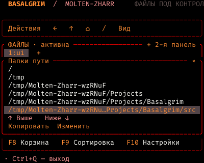

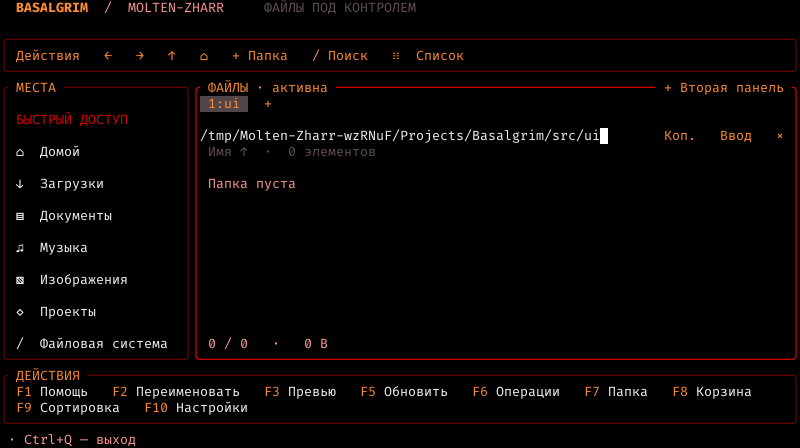

## Переименование и редактирование текста

**F2**, кнопка **Переименовать** внизу или одноимённая команда контекстного меню открывает имя прямо в строке файла или под его иконкой. У файла выделяется имя без последнего расширения, у папки — всё имя. Начните печатать, чтобы заменить выделение; `Ctrl+A` включает расширение. Enter или **✓ Ввод** подтверждает имя, Esc, **× Отмена** или щелчок снаружи отменяет ввод. Неизменённое имя закрывается без файловой операции.

Если выбрано несколько файлов, эта же команда открывает массовое переименование:

1. Введите обычное общее имя, например **Фото**, без расширения.
2. Проверьте строки **Было / Будет**: `IMG_1234.png` → `Фото_001.png`, `IMG_5678.jpg` → `Фото_002.jpg`.
3. Нажмите **Переименовать**. До этого файлы остаются как были.

Номера включены по умолчанию; переключатель **Номера** или F3 убирает и возвращает их, сохраняя введённый текст. Расширение каждого файла сохраняется автоматически. Пустое поле оставляет прежние имена — так можно только добавить номера. Порядок нумерации совпадает с сортировкой выбранной группы. Список прокручивается колесом, стрелками, PageUp/PageDown и кнопками ↑/↓, в том числе в окне 34×14.

**Свой шаблон F4** открывает отдельный режим для сложных имён; для обычного переименования он не нужен. Поля обоих режимов сохраняются при переключении. Расширение сохраняется автоматически, если вы явно не задали другое. Для сохранения не нужно дописывать `{ext}`.

В фигурных скобках задаются подстановки и их параметры: `{n:03}` добавляет номер из трёх цифр, `{ext:jpg}` задаёт расширение `.jpg`. Изменение расширения ставится в конце шаблона.

| Цель | Шаблон | Результат для `Снимок.png` |
| --- | --- | --- |
| Сохранить исходное расширение | `Photo_{n:03}` | `Photo_001.png` |
| Задать расширение `.jpg` | `Photo_{n:03}{ext:jpg}` | `Photo_001.jpg` |
| Убрать расширение | `Photo_{n:03}{ext:}` | `Photo_001` |

[Сохранение исходных расширений](../assets/screenshots/batch-template-preserve.png) · [Заданное расширение](../assets/screenshots/batch-template.png).

Переименование меняет только имя. Содержимое и формат остаются прежними: PNG с новым суффиксом `.jpg` по-прежнему содержит данные PNG.

| Запись | Значение |
| --- | --- |
| `{name}` | Имя без последнего расширения; для папки — полное имя |
| `{ext:jpg}` | Задать расширение `.jpg`; вместо `jpg` можно написать другое, например `tar.gz` |
| `{ext:}` | Убрать расширение |
| `{full}` | Полное исходное имя |
| `{n}` / `{n:03}` | Номер с единицы / номер из трёх цифр |

Запись `{jpg}` ошибочна: имя параметра `ext` пропущено. Окно указывает проблемную вставку и её позицию, показывает исправленный шаблон с `{ext:jpg}` и вариант без этой вставки для сохранения исходных расширений. Длинная подсказка прокручивается колесом, PageUp/PageDown и кнопками ↑/↓; исправления не применяются автоматически. Буквальные фигурные скобки записываются как `{{` и `}}`.

Для совместимости работают и прежние полные шаблоны: `Photo_{n:03}.jpeg` задаёт буквальное окончание `.jpeg`, `{full}` копирует полное исходное имя, а `{ext}` явно подставляет исходное расширение. Обычно они не нужны: для группы `a.png`, `b.jpg` достаточно `Photo_{n:03}`, чтобы получить `Photo_001.png`, `Photo_002.jpg`. Файлы без расширения остаются без него; точки внутри подставленного `{name}` не мешают сохранению последнего расширения (`archive.tar.gz` → `archive.tar_001.gz` для `{name}_{n:03}`).

[Пример сообщения об ошибке](../assets/screenshots/batch-template-error.png).

Занятые, повторяющиеся и недопустимые имена блокируют применение; **Обновить F5** повторяет проверку. Имена других выбранных файлов тоже считаются занятыми: перестановки имён требуют промежуточного свободного шаблона. Неизменённые файлы пропускаются. Имена вне UTF-8 показываются как ошибка без изменения исходных байтов. За раз проверяется до 10 000 файлов.

Проверка работает в фоне. При применении сверяются исходники и свободные назначения, существующие файлы не перезаписываются. Изменения после предпросмотра останавливают пакет; уже выполненная часть остаётся в журнале. Общие прогресс, **Стоп**, Ctrl+Z/Ctrl+Y и история работают для всего пакета, в том числе после перезапуска. Прерванное сбоем переименование автоматически не продолжается.

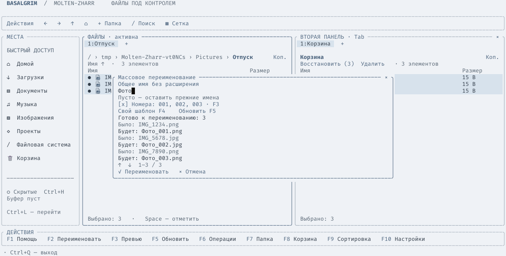

Во всех текстовых полях, включая путь, создание файла/папки, поиск и настройки:

- Стрелки и Home/End перемещают курсор; Shift расширяет выделение, Ctrl+стрелки переходят по словам. Backspace/Delete удаляют символы, с Ctrl — слова.
- Щелчок ставит курсор, протягивание мышью выделяет текст; Shift+щелчок продолжает выделение. Правый щелчок или Shift+F10 открывает только четыре текстовые команды: вырезать, копировать, вставить и выделить всё.
- `Ctrl+C/X/V` работают с выделенным текстом; также доступны Ctrl+Insert, Shift+Delete и Shift+Insert. Текстовый обмен сохраняет внутренний файловый буфер. В GUI и локальном TUI с доступным X11/Wayland буфер читается в фоне; запоздалая вставка после изменения курсора, текста или поля игнорируется. Без нативного чтения в TUI используйте вставку самого терминала, например Ctrl+Shift+V.

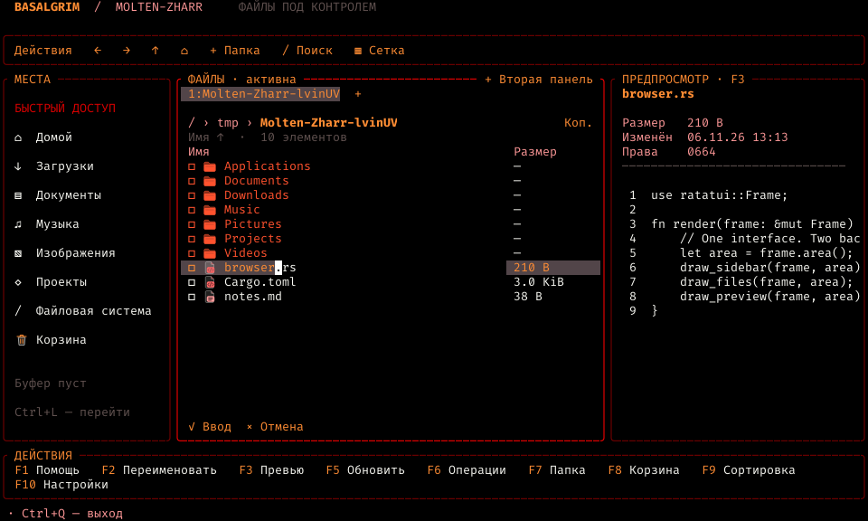

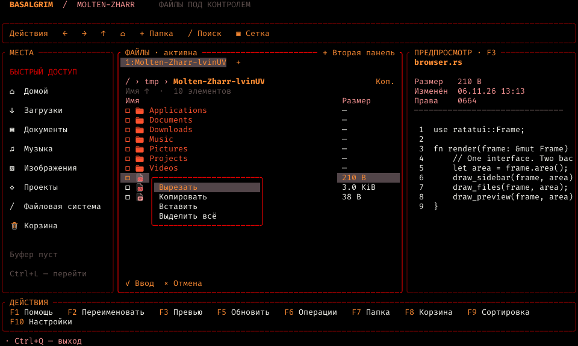

## Настройки

Откройте **Настройки** на панели команд, нажмите `F10` или `Ctrl+,`. Экран устроен как в Almavorn: разделы слева, параметры справа, описание выбранного пункта и состояние сохранения снизу. Мышь и клавиатура работают в обоих вариантах запуска.

- `Tab` / `Shift+Tab` переключают фокус между разделами, вкладками темы и параметрами. `↑`/`↓`, Home/End и PageUp/PageDown перемещают выбор; `←`/`→` меняют значение; Enter открывает редактор или выполняет действие; Esc возвращает назад.
- **Темы → Пресеты**: Molten-Zharr, Classic Amber, Classic Violet и Light. Выбор темы меняет палитру, сохраняя выбранные шрифт и геометрию. **Сбросить оформление** возвращает исходное оформление целиком.
- **Light**: светлый фон, серо-синие папки и приглушённые акценты. [Снимок светлой темы](../assets/screenshots/light.png).
- **Темы → Палитра**: нажмите на HEX-значение или Enter, введите `#RRGGBB`; `Ctrl+U` очищает поле. Изменения цветов сохраняются отдельно для каждой темы. Сброс цветов затрагивает только текущую тему.
- **Темы → Шрифт и геометрия**: Fira Code, Fira Code Bold, DejaVu Sans Mono; размер 10–32; рамки без обводки, одинарные, двойные или толстые; прямые/скруглённые углы одинарной рамки. Шрифт в окне меняется сразу, с учётом масштаба экрана. В TUI эти параметры сохраняются для оконного запуска; шрифт самого терминала контролирует терминал.
- **Темы → Иконки**: **Изображения** или **Символы**, переключение стрелками, Enter или мышью. Выбор применяется сразу и сохраняется. Если терминал не поддерживает изображения, приложение показывает символы и сохраняет предпочтение для GUI или другого терминала. Изображения в окне масштабируются под размер шрифта и DPI; наведение и выделение сохраняют свой фон.
- **Клавиши**: выберите команду и Enter, затем нажмите новое сочетание либо выберите модификаторы и клавишу мышью. Колесо прокручивает список клавиш. Esc отменяет захват. Delete на строке команды возвращает исходное сочетание, первая строка восстанавливает все назначения.
- **Сессия**: включить или отключить автоматическое сохранение и восстановление вкладок. При ошибке записи здесь доступно повторное сохранение.

Сочетания проверяются на точное совпадение модификаторов и конфликты. Стрелки, Home/End, PageUp/PageDown и Esc зарезервированы для навигации; Enter, Tab, Space и Backspace доступны для своих действий. `Ctrl+U` сохраняет значение очистки поля ввода. В диалоге захвата нажатия не запускают команды приложения. Подсказки в справке и панели действий обновляются после переназначения. Таблица выше показывает исходные назначения.

Настройки применяются сразу и сохраняются автоматически. Старый JSON, в том числе прежний `font_size`, загружается с исходными значениями новых полей. Ошибка записи отображается внизу экрана, изменения остаются в памяти; `Ctrl+S` или щелчок на сообщении повторяет сохранение. Если исходный файл повреждён или содержит конфликтующие сочетания, он сохраняется без перезаписи, а автосохранение отключается для этого запуска.

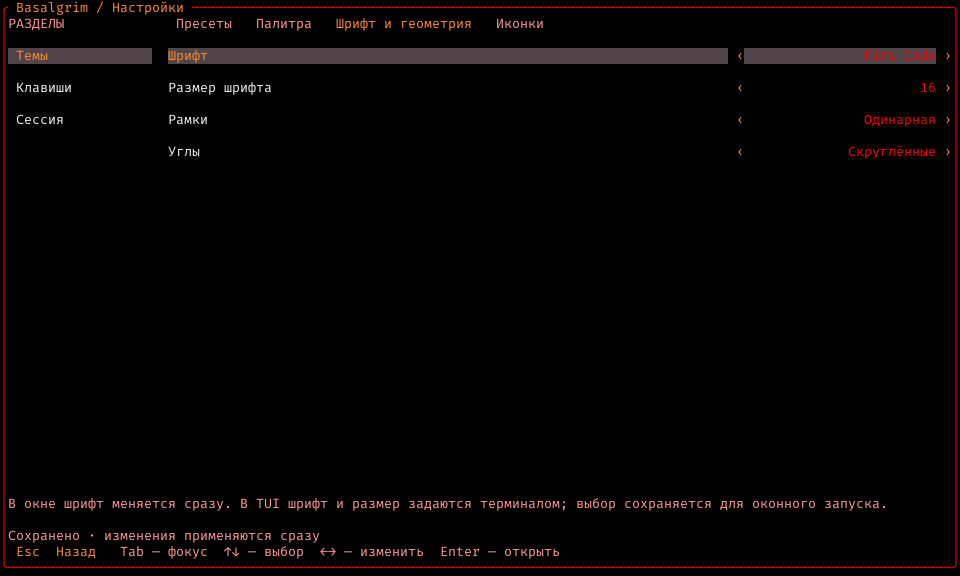

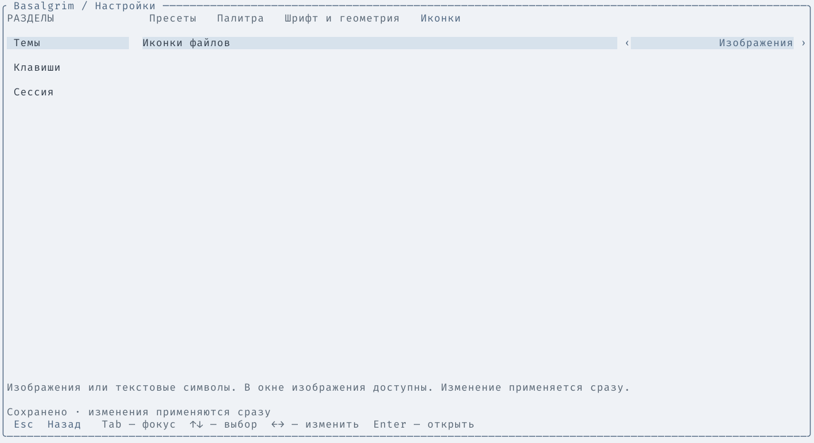

## Восстановление сессии

По умолчанию сохраняются обе панели, порядок их вкладок, каталоги и активные вкладки. При запуске без пути восстанавливается и активная панель; при однопанельном виде фокус остаётся слева, а вкладки скрытой панели сохраняются. Настройки вида загружаются отдельно. Выделение файлов, фильтр, история переходов, буфер обмена и выполнявшиеся операции не восстанавливаются. История операций хранится в отдельном журнале, в том числе при `--no-session`.

Изменения сохраняются в фоне с небольшой задержкой, а при обычном закрытии записывается окончательная сессия. При нескольких экземплярах остаётся сессия последнего закрытого окна. GUI и TUI используют один файл: `$XDG_STATE_HOME/molten-zharr/basalgrim/session.json`, обычно `~/.local/state/molten-zharr/basalgrim/session.json`.

Явно указанный каталог открывает новую сессию и сохраняет её при закрытии. Чтобы открыть папку, сохранив прежнюю сессию, используйте `--no-session /путь/к/папке`. Переключатель **F10 → Сессия → Восстанавливать сессию** отключает и автосохранение, и восстановление; после повторного включения сохраняются текущие вкладки.

Недоступная папка остаётся вкладкой с ошибкой; остальные вкладки продолжают работать. Повреждённый или неподдерживаемый файл сессии остаётся нетронутым, а приложение запускается в обычной папке с сообщением об ошибке. Автосохранение такой сессии отключается на этот запуск. Не-UTF-8 имена каталогов сохраняются без потери байтов.

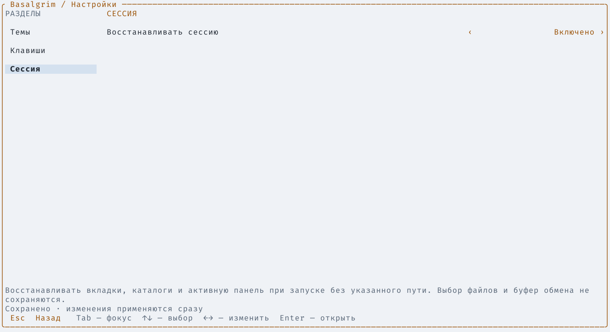

## Файловые операции

Щёлкните начальный файл, затем удерживайте Shift и щёлкните конечный: выделится диапазон в текущем порядке сортировки и фильтра. Shift со стрелками, Home/End и PageUp/PageDown расширяет или сужает его с клавиатуры; Ctrl+Shift добавляет диапазон к прежнему выбору. Начало диапазона своё у каждой вкладки, сохраняется при прокрутке и обновлении папки. Это работает в сетке, списке и корзине. В TUI Shift+щелчок доступен, если терминал передаёт его приложению: некоторые терминалы оставляют это сочетание для выделения текста.

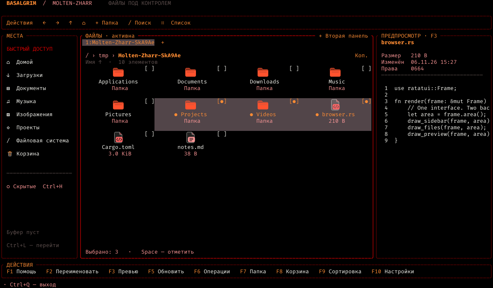

Удерживайте ЛКМ на свободном месте и двигайте мышь: рамка отмечает пересекающиеся элементы в сетке или списке. При движении обратно выбор сужается. Без модификаторов рамка заменяет выделение, с `Ctrl` — добавляет к прежнему. Отпускание ЛКМ сохраняет выбор, `Esc` или потеря фокуса отменяет растягивание и восстанавливает прежний выбор. Рамка ограничена текущей панелью; заголовки, вкладки и кнопки в неё не попадают. Пустая область снимает выбор, а обычное наведение его не меняет. В GUI рамка рисуется тонкой линией поверх иконок, в TUI — символами.

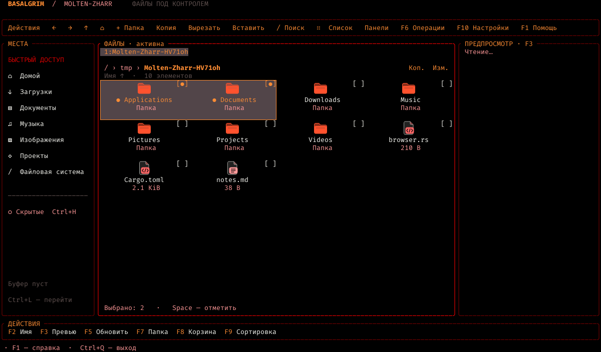

Правый щелчок по файлу или папке открывает короткое меню: открыть, копировать, вырезать, переименовать, дублировать, отправить в корзину. В режиме двух панелей добавляются копирование и перемещение в соседнюю панель. Для отмеченной группы остаются применимые ко всем файлам команды. Ctrl+щелчок или отметки рядом с именами собирают группу; ПКМ по отмеченному элементу её сохраняет.

ПКМ по свободному месту открывает действия с текущей папкой: создать файл или папку, вставить, изменить сортировку, вид и показ скрытых файлов, обновить, отфильтровать или выбрать всё. Недоступные действия не показываются; например, вставка появляется при заполненном файловом буфере. Размер меню подстраивается под его содержимое. Наведение подсвечивает только строку, включая неактивные строки полного списка; рамка и фон меню не подсвечиваются.

Полный список команд, включая вкладки, настройки и операции, доступен через «Действия» или `Shift+F10`. Длинный список прокручивается колесом и кнопками «Ещё команды». Щелчок снаружи или по × закрывает меню без запуска команды под ним.

`Ctrl+C/X/V` вызывают общие файловые команды; доступность системного обмена описана ниже. В полях имени и пути `Ctrl+V` вставляет системный текст. Пользовательские сочетания сохраняют точные модификаторы в обоих интерфейсах.

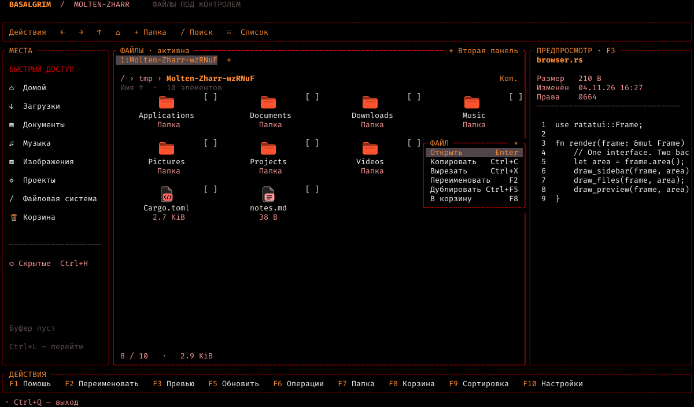

### Перетаскивание файлов внутри Basalgrim

Зажмите ЛКМ на имени или иконке и перетащите файл на папку, свободное место другой панели или вкладку. Если нажатый файл входит в отмеченную группу, переносится вся группа. Вкладка принимает файлы в свой каталог, оставаясь неактивной. Несколько вкладок видны и в компактном окне.

По умолчанию файлы **перемещаются**; удерживайте **Ctrl при отпускании**, чтобы копировать. Назначение подсвечивается, строка внизу показывает действие и число файлов. У верхнего или нижнего края файловой области работает автопрокрутка без переключения панели. **Esc**, потеря фокуса или отпускание вне допустимой цели отменяют жест и восстанавливают прежний выбор. Смена каталога, вкладки или размера файловой области также отменяет незавершённый перенос. Папку нельзя бросить в себя или в её потомка.

Конфликты, прогресс, отмена операции и undo/redo общие с другими файловыми командами. Сам жест не записывает новые файлы в буфер обмена. Для восстановления из корзины используются её команды «Восстановить» и «Восстановить в текущую папку». В TUI терминал должен передавать приложению события зажатой кнопки и движения мыши.

Рамку выделения начинайте с пустого места: в сетке подходят промежутки между элементами, в списке — свободные строки и узкое поле у правой границы.


Папки в адресной строке также принимают файлы: бросьте файл или группу на нужного родителя, чтобы поднять их на один или несколько уровней. Просматриваемый каталог при этом не меняется; Ctrl при отпускании копирует файлы.

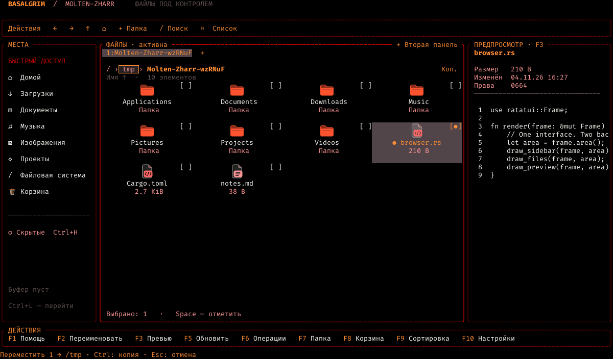

### Перетаскивание между приложениями

В GUI перетаскивайте файл или отмеченную группу за пределы окна в другое приложение. В обратную сторону доступны те же папки, свободное место, вкладки и части пути, что и для внутренних переносов. Буфер обмена сохраняется. Полученные файлы используют общие конфликты, прогресс, отмену и undo/redo; действие в другом приложении выполняет получатель.

| Запуск | Внешнее перетаскивание |
| --- | --- |
| GUI X11 | [XDND](https://www.freedesktop.org/wiki/Specifications/XDND/), копирование/перемещение и пакетные URI через INCR |
| GUI Wayland | [wl_data_device](https://wayland.freedesktop.org/docs/html/apa.html#protocol-spec-wl_data_device); действие согласуется с получателем и композитором |
| Локальный TUI | [Kitty OSC 72](https://sw.kovidgoyal.net/kitty/dnd-protocol/) при положительном ответе терминала на запрос поддержки, независимо от режима иконок |
| Остальные терминалы, неподдерживающие мультиплексоры и SSH | Внутреннее перетаскивание и файловые команды |

Для копирования в Wayland зажмите Ctrl до выхода из окна: такая внешняя сессия предлагает только копирование. Без этого получатель и композитор выбирают доступное действие. Отменой нативной сессии управляет оконная система; не все Wayland-композиторы передают Escape приложениям во время drag. Сброс на область, не принимающую файлы, отменяет перенос. После сброса ожидание списка можно остановить мышью кнопкой **Стоп** или через Esc.

Принимаются только локальные `file:` URI: не более 4096 путей и 4 MiB данных, с сохранением произвольных Unix-байтов в именах. Текстовая вставка не считается файловым сбросом. Назначение фиксируется до чтения списка; устаревшие ответы после смены вкладки, каталога, размеров или отмены не запускают операцию. Приложение-источник не удаляет файлы по одному лишь уведомлению об успешном завершении: локальный перенос выполняет получатель.

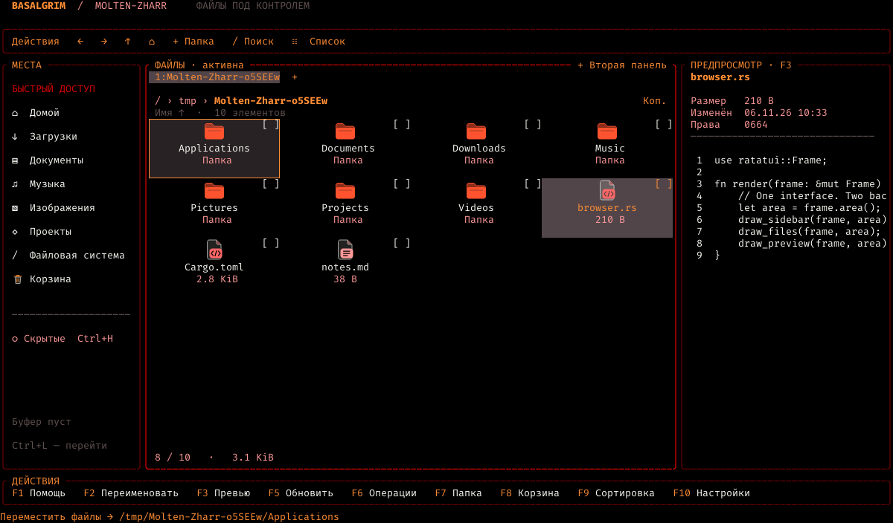

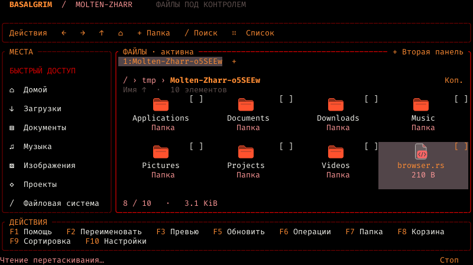

### Системный файловый буфер

**Ctrl+C**, **Ctrl+X**, **Ctrl+V** обмениваются файлами с другими Linux-менеджерами. Те же команды доступны через ПКМ: копирование/вырезание — у файла или группы, вставка — на свободном месте текущей папки. Переназначенные сочетания тоже работают.

| Запуск | Файловый буфер |
| --- | --- |
| GUI X11 | Нативная X11 selection, несколько форматов одновременно, большие списки через INCR |
| GUI Wayland | Буфер соединения окна; для чтения и записи нужен фокус |
| Локальный TUI в Wayland | Нативный буфер через ext/wlr data-control; иначе доступный XWayland |
| Локальный TUI в X11 | Нативный X11 буфер при доступном DISPLAY |
| TUI без доступного протокола или через SSH | Внутренний файловый буфер Basalgrim |

Файловый буфер предоставляется, пока работает приложение; сохранение после выхода зависит от менеджера буфера рабочего стола. Передаются `text/uri-list`, [формат Nautilus](https://github.com/GNOME/nautilus/blob/main/src/nautilus-clipboard.c) `x-special/gnome-copied-files` и [признак вырезания KDE](https://github.com/KDE/kio/blob/master/src/widgets/paste.cpp) `application/x-kde-cutselection`. Поддерживаются только локальные `file:` URI: пробелы, кириллица и исходные Unix-байты имён сохраняются. Предел — 4096 путей и 4 MiB на формат. Обычный текст и сетевые URI файловыми командами не интерпретируются; OSC 52 используется только для текста.

Чтение выполняется в фоне с ограниченным ожиданием и кнопкой **Стоп**. Каталог назначения фиксируется при нажатии «Вставить». Конфликты, прогресс, отмена и журнал общие с остальными операциями. При вырезании из буфера исключаются только завершённые перемещения. Завершение операции не перезаписывает новый буфер другого приложения. Копирование адреса сохраняет внутренний файловый выбор этого запуска; новая внешняя текстовая запись отменяет возможность вставки прежних файлов через системный буфер.

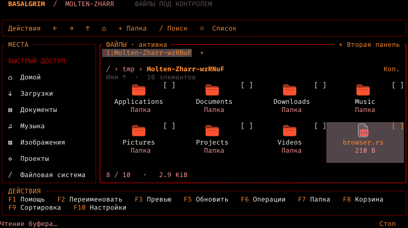

### Соседняя панель и дублирование

Включите две панели через **Ctrl+D** или **+ Вторая панель** в заголовке. **Shift+F5** копирует выбранные файлы в каталог активной вкладки соседней панели, **Shift+F6** перемещает их туда. Команды доступны в контекстном меню файла или группы и в общем меню «Действия», в том числе в компактном окне. Если соседняя панель отключена, ещё открывает каталог или показывает ошибку, команды недоступны.

**Ctrl+F5** или пункт **Дублировать** создаёт копии в текущей папке: `file (1).txt`, `file (2).txt` и далее. Для группы каждый элемент получает свободное имя; папки и ссылки тоже поддерживаются. Дополнительный диалог выбора имени не нужен.

Эти команды запускаются сразу, сохраняя файловый буфер. Источник, выбранная группа и назначение фиксируются при запуске: последующее переключение вкладок и панелей не перенаправляет операцию. Прогресс, отмена и совпадения имён при переносе работают так же, как при вставке. Из буфера вырезания убираются только действительно перемещённые пути; пропущенные остаются. Существующие назначения F5 и F6 сохраняются, новые сочетания можно изменить в настройках.

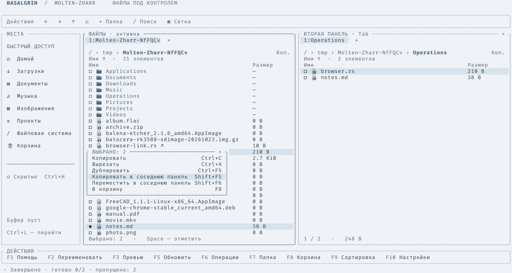

### Выполнение операций

На Linux готовые элементы публикуются через атомарный `RENAME_NOREPLACE`, без неявной перезаписи. Копирование сначала создаёт временное дерево в целевой файловой системе; при ошибке до публикации оно удаляется. Символические ссылки копируются как ссылки; специальные файлы отклоняются.

Каждый элемент пакета выполняется отдельно. При первой ошибке пакет останавливается, интерфейс сообщает число завершённых элементов и причину. Уже завершённые элементы остаются; пропущенные и неудавшиеся элементы вырезания сохраняются в буфере. Автоматического отката пакета пока нет.

При перемещении между файловыми системами Basalgrim копирует во временную папку на целевом диске, проверяет состав дерева, идентичность исходных файлов и содержимое по байтам, синхронизирует копию и публикует её без перезаписи. Затем исходник временно получает приватный путь на прежнем диске, повторно проверяется и удаляется. При обнаруженном изменении перенос останавливается. Для проверки вложенных точек монтирования требуется Linux 5.8 или новее; такие точки автоматически не переносятся.

Если копия опубликована, но удаление исходника не завершено, она сохраняется. В **F6 → Операции** отдельно показаны созданная копия и незавершённый источник. Такой элемент не считается успешно перемещённым и остаётся в буфере вырезания. Остаток исходника возвращается на прежний путь; если тот уже занят, приложение сохраняет остаток в `.basalgrim-move-*`, показывает его точный путь и направляет буфер вырезания на него. Новый файл на прежнем пути остаётся нетронутым.

Копирование сохраняет обычные права доступа. Между файловыми системами перемещение дополнительно сохраняет время изменения обычных файлов и папок. Владелец, ACL, xattrs и структура жёстких ссылок пока не переносятся; время изменения символических ссылок тоже может отличаться. Проверки не создают атомарный снимок и не блокируют изменения после последней проверки, в том числе через ранее открытые другими программами дескрипторы. Выход через интерфейс блокируется до завершения операции или её отмены с очисткой временных данных.

### Совпадения имён

Если цель занята, включая сломанную ссылку, операция ждёт выбора в общем диалоге GUI/TUI. В нём показаны пути, типы, размер обычных файлов и даты изменения.

| Выбор | Результат |
| --- | --- |
| Заменить | Заменяет существующий объект целиком. Папки не объединяются, прежнее содержимое сохраняется для отмены. У ссылки заменяется сама ссылка. |
| Пропустить | Сохраняет источник и цель; продолжает пакет. Пропуски отдельно видны в истории операций. |
| Сохранить оба | Подбирает свободное имя: `file (1).txt`, `file (2).txt` и далее. |
| Отменить операцию | Останавливает пакет с безопасной очисткой текущего шага. Завершённые элементы остаются. |

Все варианты доступны мышью. `↑`/`↓` или `Tab` выбирают действие, `Enter` подтверждает; по умолчанию выбран вариант **Сохранить оба**. Флажок **Для оставшихся** или `Пробел` применяет решение к следующим конфликтам только этого пакета. `Esc`, × и команда остановки отменяют операцию. Замена объекта самим собой недоступна; перемещение на тот же путь считается пропуском.

При замене прежняя цель остаётся на месте до готовности нового элемента. Перед публикацией проверяются её идентичность и метаданные; обнаруженное изменение требует нового выбора даже при включённом флажке. Если публикация не удалась, прежняя цель восстанавливается без перезаписи. В обычном GUI/TUI прежние данные сохраняются в `.basalgrim-replaced-*` для undo/redo, точный путь показан в **F6 → Операции**. Эта папка не удаляется автоматически.

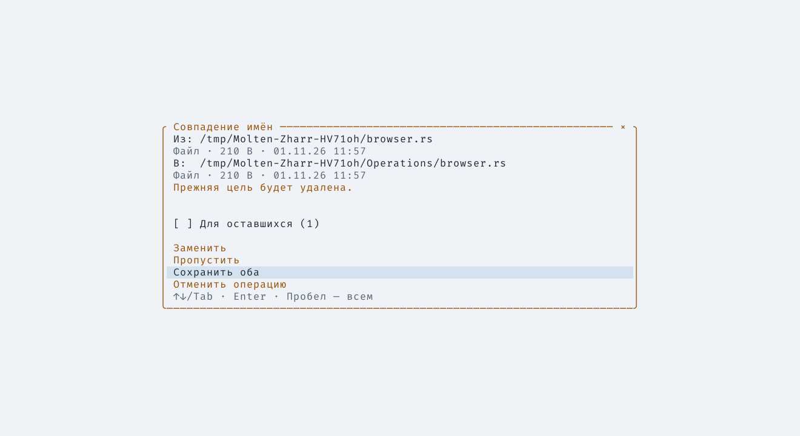

## Прогресс и отмена

Во время операции нижняя строка показывает число завершённых элементов и обработанный объём. Копирование предварительно подсчитывает файлы и размер; оценка может уточняться, если источник меняется. Нажмите на индикатор или **F6**, чтобы открыть экран операций: текущая задача, результат, исходный и целевой пути, завершённые элементы и последние 20 операций из постоянного журнала. `↑`/`↓` выбирают операцию, `PgUp`/`PgDn` и колесо над деталями прокручивают подробности; `Esc` закрывает экран, сохраняя выполняющуюся задачу. **F5** или щелчок по заголовку обновляет журнал, включая результаты другого окна.

**Ctrl+F6** или кнопка **Стоп** запрашивает отмену. Копирование останавливается между порциями данных и перед публикацией готового элемента; временная незавершённая копия очищается, исходник сохраняется. Между дисками отмена также проверяется при проверке копии и перед началом удаления исходника. Если копия уже опубликована, отмена сохраняет её и исходник; результат отмечается как незавершённый перенос. Начавшееся удаление исходного элемента завершается без прерывания, затем пакет останавливается перед следующим элементом. Переименование, перемещение внутри файловой системы и корзина завершают текущий атомарный шаг. Ошибки очистки показываются явно.

Клавиши можно переназначить в настройках. Старые назначения сохраняются: новые команды получают свободные сочетания.

## Корзина

Откройте **Корзина** в боковой панели, **Открыть корзину** в меню «Действия» или нажмите `Ctrl+Shift+B`. Она занимает обычную файловую панель: сохраняются навигация, вкладки, сетка/список, иконки и предпросмотр. Соседняя панель работает независимо; «Назад» возвращает прежнюю папку. В списке видна дата удаления, внизу — исходный путь выбранного элемента. Отметки, `Ctrl` + щелчок, выделение рамкой, Space, `Ctrl+A` и колесо работают как в обычной папке. Поиск `/` или `Ctrl+F` фильтрует имена и исходные пути, F9 переключает сортировку по дате удаления и имени. Список обновляется в фоне; `F5` обновляет сразу.

**Восстановить** возвращает выбранные элементы на исходные места. **Восстановить в текущую папку** в коротком меню восстанавливает их в папку, из которой была открыта корзина; адрес показан в подтверждении. Двойной щелчок или Enter также открывает подтверждение. ПКМ по файлу предлагает восстановление или безвозвратное удаление выбранного элемента либо группы; по свободному месту — очистку и команды просмотра. Меню «Действия» содержит только доступные команды корзины. Совпадения имён обрабатывает общий диалог «Сохранить оба», «Заменить», «Пропустить», «Отменить». Файловый буфер копирования/вырезания сохраняется.

Показываются домашняя корзина и доступные корзины подключённых файловых систем по [спецификации freedesktop](https://specifications.freedesktop.org/trash/latest/). Чтение ограничено 20 000 элементами и размером метаданных; причина недоступности восстановления показывается внизу панели. Файлы без корректного `.trashinfo`, с небезопасными адресами или изменёнными метаданными не восстанавливаются по догадке. Исходные имена берутся из метаданных, а пути с байтами вне UTF-8 сохраняются без потерь.

Восстановление выполняет файловый worker с обычными прогрессом, отменой через `Ctrl+F6` и журналом. Завершённое восстановление можно отменить через `Ctrl+Z` и повторить через `Ctrl+Y`, в том числе после перезапуска; точные метаданные сохраняются в закрытой `.basalgrim-restore-*`. После сбоя сохранённые данные не удаляются и операция не продолжается автоматически: известные пути доступны в F6. Сохранёнными данными управляет экран **Хранилище undo/redo** в F6.

**Удалить** (`Delete`/`Shift+Delete`) удаляет только выбранные элементы корзины. **Очистить корзину** на панели, в меню фона или «Действия» удаляет все элементы, включая скрытые фильтром и повреждённые метаданные. Обе команды показывают отдельное подтверждение: такое удаление нельзя отменить через undo. Перед подтверждением очистки перечитывается вся корзина; новые поступления после подтверждения остаются для следующей очистки. Прогресс и отмена доступны как у других операций; после начала удаления отдельного элемента он завершается целиком, отмена останавливает следующий. Символические ссылки не раскрываются, вложенные точки монтирования блокируют удаление. История undo/redo не очищается этой командой.

Для работы только с домашней корзиной можно запустить с `--trash-home-only`: просмотр и очистка ограничиваются `$XDG_DATA_HOME/Trash`. Без этого флага включены и доступные корзины подключённых файловых систем. Оконные и PTY-проверки удаления используют этот флаг и отдельные HOME/XDG-каталоги, чтобы не затрагивать чужие корзины на общих дисках.

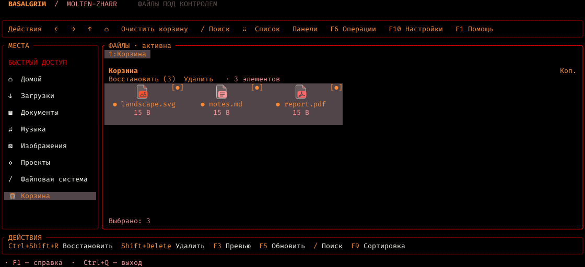

## Постоянный журнал операций

GUI и TUI используют `$XDG_STATE_HOME/molten-zharr/basalgrim/operations.sqlite3`, обычно `~/.local/state/molten-zharr/basalgrim/operations.sqlite3`. В F6 доступны последние 20 операций; полная история остаётся в базе. Для больших пакетов интерфейс загружает до 200 путей, сохраняя точные общие счётчики.

Перед изменением пользовательских данных записывается намерение, затем — результат шага, фактическая цель и идентичность файла: устройство, inode, тип, размер, права и времена изменения. Пути сохраняются как байты, включая не-UTF-8 имена. Записываются также временные пути копирования, замены и переноса. Работа с базой выполняется в файловом worker; используются [WAL](https://sqlite.org/wal.html) и [`synchronous=FULL`](https://sqlite.org/pragma.html#pragma_synchronous).

Если намерение не удалось сохранить, изменение не начинается. Ошибка записи после успешного изменения не отменяет его: завершённый элемент учитывается, а остальные элементы пакета останавливаются. Неподдерживаемая или повреждённая база сохраняется нетронутой; до восстановления доступа файловые команды показывают ошибку журнала. После устранения причины обновите F6.

После аварийного завершения оставшаяся работа получает статус **Прервано: нужна проверка**. Журнал не считает незавершённый шаг успешным и не откатывает его автоматически. В деталях показаны известные пути, которые нужно проверить. Открытые экземпляры различаются по удерживаемым блокировкам, поэтому работа другого живого окна остаётся выполняющейся.

Журнал версии 1 автоматически обновляется до версии 2 без выполнения файловых действий. Старые записи остаются видимыми; без новых проверяемых снимков отмена для них недоступна. Запись журнала и изменение файловой системы являются отдельными действиями: при сбое между ними результат требует проверки по фактическим файлам.

## Отмена и повтор завершённых операций

**Ctrl+Z** отменяет последнюю доступную операцию, **Ctrl+Y** повторяет отменённую. В **F6** эти сочетания и кнопки **Отменить / Повтор** действуют на выбранную запись; кнопки доступны и в минимальном окне. Команды также есть в общем меню **Действия**, клавиши переназначаются в настройках. **Ctrl+F6 / Стоп** по-прежнему останавливает выполняющуюся работу.

Поддерживаются создание файла/папки, копирование, дублирование, перемещение, переименование и отправка в корзину, включая группы и замену существующей цели. Для отмены копирования/создания результат перемещается в закрытую `.basalgrim-undo-*` на той же файловой системе; повтор возвращает эти данные и не зависит от сохранности исходника. Замена возвращает прежний объект целиком, затем может быть повторена. Перенос между дисками использует тот же проверяемый движок, что и обычное перемещение. При последовательном откате собственного междискового переноса обновляются связанные снимки прежних операций; внешняя подмена файла не принимается за такое продолжение.

Перед изменением проверяются inode, тип, права, владелец, состав дерева, ссылки и SHA-256 содержимого обычных файлов. Чтение и проверка выполняются в worker, ссылки не разыменовываются, вложенные точки монтирования не обходятся. Снимок ограничен 100000 элементами, 128 уровнями, 4 MiB относительных путей и 32 MiB данных плана; сами файлы хешируются порциями без загрузки целиком. Превышение ограничений или отсутствие доказательств отключает отмену с объяснением в F6. При изменении результата или занятом пути отмена/повтор останавливаются без перезаписи. Частично отменённую группу можно продолжить или повторить; завершённые элементы учитываются точно. Начатый составной элемент безопасно завершается перед остановкой пакета.

Корзина по-прежнему использует `gio trash`. Для восстановления сохраняются точный элемент и его `.trashinfo` по [спецификации freedesktop](https://specifications.freedesktop.org/trash/latest/); проверяются и данные, и метаданные. Повтор снова отправляет файл через gio и сохраняет новый адрес. Неоднозначный адрес, очистка системной корзины или изменённые метаданные блокируют автоматическое восстановление.

История и возможность повтора переживают перезапуск GUI/TUI, в том числе с `--no-session`. Отмены и повторы также журналируются. Аварийно прерванный откат не продолжается автоматически: запись блокируется, известные пути остаются в деталях. Файлы для повтора и прежние цели замены занимают место в скрытых служебных папках; удалить их можно только через явную очистку хранилища.

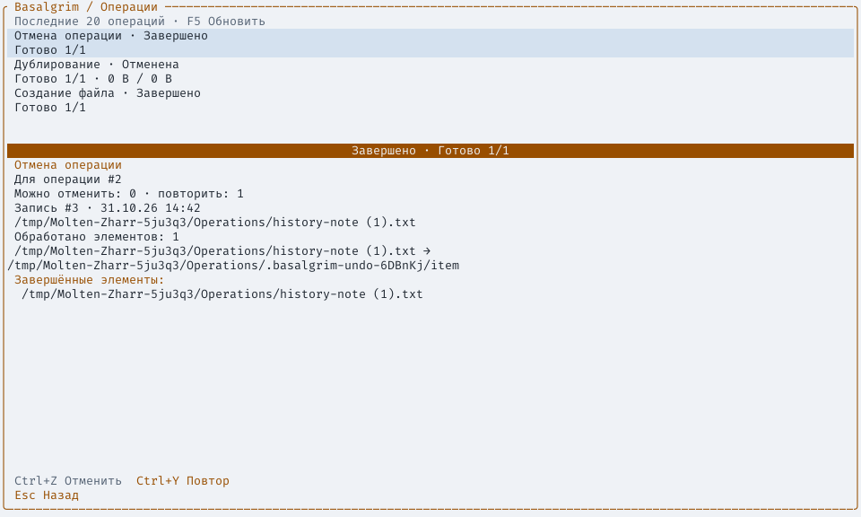

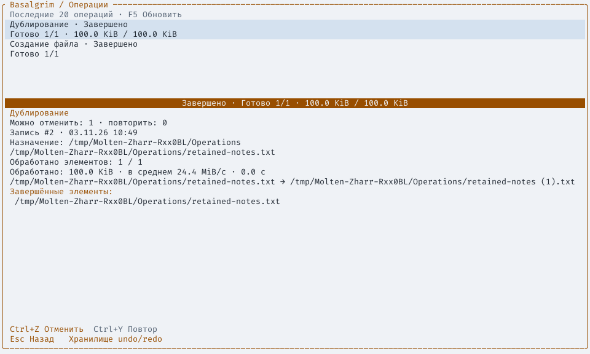

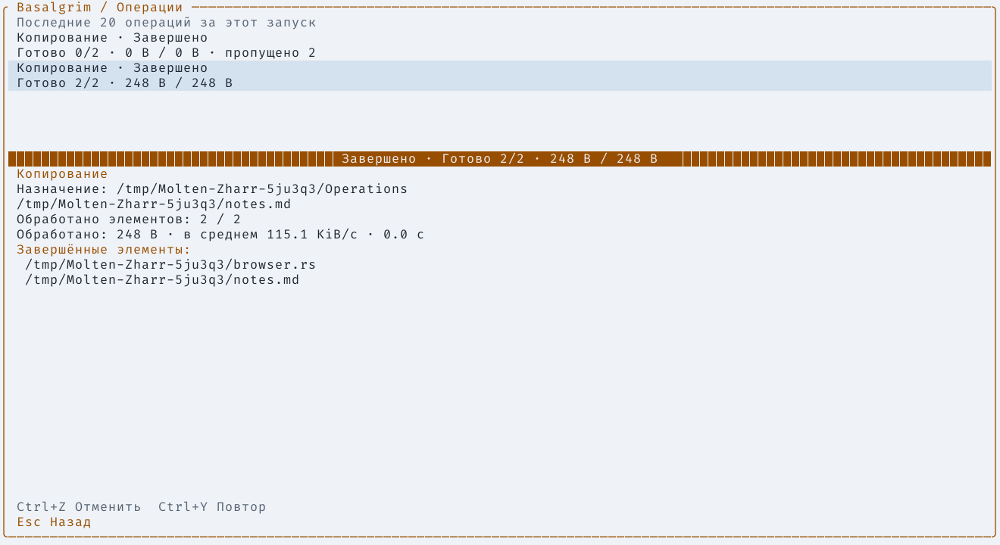

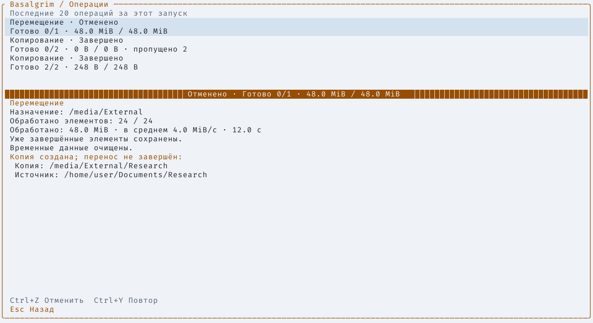

## Хранилище undo/redo

Откройте **F6 → Хранилище undo/redo**, одноимённую команду в «Действия» или нажмите **Ctrl+Shift+F6**. Экран показывает объём проверенных сохранённых данных, записи, доступные для очистки, и причины защиты остальных. Подсчёт и проверка выполняются в фоне; **Обновить** или F5 пересчитывает данные, Esc возвращает историю. Мышь и клавиатура доступны в том числе при 34×14.

**К очистке** выбирает все записи либо записи старше **7, 30 или 90 дней**; щёлкните по строке или нажмите стрелку влево/вправо. Выбор сохраняется в настройках. Возраст считается с последнего изменения состояния undo/redo. Данные хранятся без автоматического удаления: этот срок определяет состав следующей ручной очистки.

**Очистить / Enter** открывает подтверждение с числом записей и объёмом. Очистка удаляет сохранённые файлы для повтора, прежние цели замены и сохранённые метаданные восстановления; отмена и повтор выбранных записей станут недоступны. Рабочие результаты операций, исходники, остальные файлы и содержимое системной корзины сохраняются. Сам журнал остаётся доступен; освобождённые страницы SQLite используются повторно, файл базы не удаляется.

Объём — логический размер проверенных файлов и ссылок, без рабочих результатов и базы журнала. Данные изменённых, незавершённых, неподтверждённых или используемых другой записью объектов не входят в этот объём и защищены от очистки; причины и известные пути показаны отдельно. Инвентаризация ограничена 10000 записями и 64 MiB планов: при превышении очистка недоступна. Перед удалением повторно проверяются снимки, пути и состояние журнала. Другая выполняющаяся файловая операция останавливает удаление.

Очистка использует общий прогресс и **Ctrl+F6 / Стоп**. Подготовку можно отменить; после начала удаления данных одной записи она завершается перед остановкой пакета. После аварийного прерывания остатки сохраняются, запись блокируется и не очищается автоматически. Путь к остаткам доступен в F6 и в списке защищённых записей.

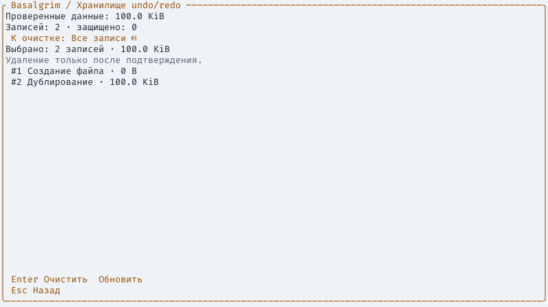

## Устройство проекта

| Файл | Ответственность |
| --- | --- |
| `src/app.rs`, `src/app/` | Общие действия, навигация, диалоги, обработка ввода и результатов |
| `src/model.rs` | Панели, вкладки, выбор, фильтр и история |
| `src/session.rs`, `src/app/session.rs` | Проверка и восстановление сессии, фоновая атомарная запись и завершение при закрытии |
| `src/worker.rs`, `src/worker/watch.rs`, `src/app/directories.rs` | Фоновые чтения, наблюдение за открытыми каталогами и применение обновлений |
| `src/fs.rs`, `src/fs/operations.rs`, `src/fs/operations/` | Чтение, предпросмотр, безопасные операции, разрешение конфликтов и проверяемый перенос между дисками |
| `src/conflicts.rs`, `src/app/conflicts.rs`, `src/ui/conflicts.rs` | Общий протокол решений и диалог совпадений имён |
| `src/operations.rs`, `src/app/operations.rs`, `src/ui/operations.rs` | Прогресс, отмена, история и общий экран операций |
| `src/journal.rs`, `src/journal/`, `src/app/journal.rs` | SQLite, намерения/результаты, снимки и SHA-256, проверяемая отмена/повтор, точные адреса корзины и загрузка истории |
| `src/ui.rs`, `src/ui/` | Общая отрисовка Ratatui и области щелчков |
| `src/main.rs`, `src/raster.rs` | egui/eframe, egui_ratatui, Fira Code и ввод GUITUI |
| `src/icons.rs`, `src/icons/`, `assets/icons/` | Типы и области иконок, SVG-растеризация, проверка терминала и фоновое кодирование графики |
| `src/preview.rs`, `src/preview/` | Ограниченное декодирование изображений, геометрия предпросмотра, кэш и фоновое кодирование для терминала |
| `src/bin/tui.rs` | Crossterm, мышь, вставка текста, восстановление терминала |
| `src/app/path.rs`, `src/ui/path.rs`, `src/clipboard/` | Переходы по частям пути, общий редактор и отдельный текстовый буфер GUI/TUI |
| `src/settings.rs` | JSON-настройки с serde defaults и атомарным сохранением |
| `src/preferences.rs`, `src/app/settings.rs`, `src/ui/settings.rs` | Палитры и шрифты, управление экраном настроек и его общий рендер |

Результаты чтения каталогов проверяются по идентификатору запроса вкладки. Предпросмотр использует отдельную очередь с выбором последнего запроса. Длительные операции не исполняются в потоке интерфейса. Состояние выделения и данные файлов используют `PathBuf`, отображаемые имена очищаются от управляющих символов.

Наблюдение через Linux inotify охватывает каталоги всех открытых вкладок обеих панелей. Серии событий объединяются; устаревшие чтения отменяются между элементами. Фоновое обновление сохраняет прежний список до получения результата и не применяется во время диалога, выделения рамкой, переноса мышью или файловой операции. При удалении или замене самой папки наблюдение восстанавливается; если оно недоступно, используется периодическое обновление. Внешние изменения на удалённых файловых системах могут не порождать локальные события inotify — для них остаётся ручное обновление.

## Проверка и изображения интерфейса

Проверки выполняются локально. GitHub Actions CI отключён; workflow удалён из репозитория.

Для сборок и тестов используйте `python3 scripts/cargo_local.py` вместо `cargo`.
Обёртка выполняет команды последовательно и проверяет фактический размер `target/`
до, во время и после команды. Бюджет — 8 ГиБ: старый кэш очищается перед запуском;
при превышении во время сборки команда останавливается, `target/` очищается, а
обёртка возвращает ошибку 75. Проверка идёт каждые две секунды, это не квота
файловой системы. Очистка удаляет всё содержимое `target/`, включая временные
снимки и тестовые инструменты; исходники и `assets/screenshots/` остаются.
Обычный запуск `cargo` использует компактные профили, но обходит контроль размера.
В профилях dev/test отключены отладочные символы и incremental-кэш; проверки
переполнений и debug assertions сохраняются. Текущий объём:
`python3 scripts/cargo_local.py status`.

```sh
cargo fmt --check
python3 scripts/cargo_local.py clippy --all-features --all-targets -- -D warnings
python3 scripts/cargo_local.py test --all-features --all-targets
python3 scripts/cargo_local.py test --no-default-features --features tui --all-targets
python3 scripts/cargo_local.py run --example preview

# Проверка настоящего TUI в PTY с отдельной корзиной и настройками
python3 scripts/cargo_local.py build --no-default-features --features tui --bin basalgrim-tui
python3 scripts/smoke_tui.py
python3 scripts/smoke_icons.py
python3 scripts/smoke_preview.py
python3 scripts/smoke_operations.py
python3 scripts/smoke_selection.py
python3 scripts/smoke_drag_drop.py
python3 scripts/smoke_scroll.py
python3 scripts/smoke_paths.py
python3 scripts/smoke_text_edit.py
python3 scripts/smoke_watch.py
python3 scripts/smoke_move.py
python3 scripts/smoke_conflicts.py
python3 scripts/smoke_panes.py
python3 scripts/smoke_session.py
python3 scripts/smoke_journal.py
python3 scripts/smoke_undo.py
python3 scripts/smoke_history_storage.py
python3 scripts/smoke_trash.py

# Настоящий GUI на отдельном X-сервере (нужны Xvfb, xclip, Python Pillow)
python3 scripts/cargo_local.py build --bin basalgrim
python3 scripts/smoke_gui.py target/debug/basalgrim

# Отдельная headless Wayland-сессия (sway, wtype, wl-clipboard, grim,
# C-компилятор, wayland-scanner, pkg-config и Wayland client headers)
python3 scripts/smoke_gui_wayland.py target/release/basalgrim

# Файловый буфер: изолированные GUI и PTY на каждом оконном бэкенде
python3 scripts/cargo_local.py build --all-features --bins
python3 scripts/smoke_gui.py target/debug/basalgrim --clipboard-only
python3 scripts/smoke_gui_wayland.py target/debug/basalgrim --clipboard-only

# Переносы мышью в приватных X11/Wayland GUI
python3 scripts/smoke_gui.py target/debug/basalgrim --drag-drop-only
python3 scripts/smoke_gui_wayland.py target/debug/basalgrim --drag-drop-only

# Переносы на адресную строку и кнопки вкладок/второй панели
python3 scripts/smoke_gui.py target/debug/basalgrim --chrome-only
python3 scripts/smoke_gui_wayland.py target/debug/basalgrim --chrome-only

# Общий редактор имён и пути: настоящие X11/Wayland, выделение и текстовый буфер
python3 scripts/smoke_gui.py target/debug/basalgrim --text-edit-only
python3 scripts/smoke_gui_wayland.py target/debug/basalgrim --text-edit-only

# Диапазоны Shift/Ctrl+Shift: клавиатура, мышь и точный набор скопированных файлов
python3 scripts/smoke_range_selection.py target/debug/basalgrim-tui
python3 scripts/smoke_gui.py target/debug/basalgrim --range-selection-only
python3 scripts/smoke_gui_wayland.py target/debug/basalgrim --range-selection-only

# Массовое переименование: предпросмотр, конфликты, мышь и undo/redo
python3 scripts/smoke_batch_rename.py target/debug/basalgrim-tui
python3 scripts/smoke_gui.py target/debug/basalgrim --batch-rename-only
python3 scripts/smoke_gui_wayland.py target/debug/basalgrim --batch-rename-only
```

`cargo run --example preview` создаёт PPM-снимки реального рендера в `target/preview/`: сетка, список, две панели, компактный интерфейс, справка, светлая тема и страницы настроек. Графическая сессия для неё не нужна. Демонстрационные файлы создаются во временной папке. PTY-проверка дополнительно проверяет редактор шрифта, тему, захват сочетаний и восстановление настроек после перезапуска.

`smoke_paths.py` проверяет переходы по частям пути и историю, полный адрес с пробелами и кириллицей в OSC 52, редактор, сохранение файлового буфера и список родителей в окне 34×14. Отдельные запуски проверяют локальный обработчик буфера и сообщение об отсутствии поддержки в Linux-консоли. Оконные сценарии читают результат из настоящих буферов приватных X11/Wayland-сессий.

`smoke_icons.py` эмулирует ответы терминалов Kitty/Sixel/iTerm2 и терминал без графики, включая отсутствие любых ответов. Проверяет вывод изображений или символов, переключение и сохранение режима, изменение размеров, последующий ввод и восстановление терминала. Подготовка и кодирование терминальных изображений выполняются в отдельном потоке с проверкой идентификатора запроса и поколения кэша. Проверка возможностей ограничена 500 мс и завершается до запуска обработчика ввода; настройки терминала или tmux автоматически не меняются.

Декодирование предпросмотра выполняется в фоне: до 32 MiB исходного файла, 16 мегапикселей, 16384 пикселей по стороне и 64 MiB декодированных данных; сохраняется уменьшенный кадр до 1024 × 1024. Лимиты памяти декодеров дополнительно задаются через [image::Limits](https://docs.rs/image/0.25.10/image/struct.Limits.html). Для SVG: до 1 MiB и 20000 XML-тегов; отображаются векторные фигуры, без текста, внешних ресурсов и вложенных изображений. Кэш содержит один подготовленный кадр для текущих размеров/фона. При превышении ограничений, повреждённом или неподдерживаемом формате панель показывает причину. Изображение скрывается под пересекающим его диалогом, при отключении предпросмотра и в узком окне. [Снимок интерфейса](../assets/screenshots/image-preview.png).

`smoke_preview.py` проверяет в PTY изображение при символьных иконках, все три протокола и отсутствие графики, внешнюю перезапись того же файла, меню поверх предпросмотра, изменение размеров, переход к тексту и отключение F3. Оконные проверки также сравнивают реальные пиксели предпросмотра в X11/Wayland.

`smoke_operations.py` запускает настоящее копирование во временной папке, отменяет его через Ctrl+F6, проверяет очистку незавершённой копии и сохранность исходника, затем выполняет следующую операцию. Проверка не затрагивает пользовательские файлы или корзину.

`smoke_move.py` переносит файлы, папки и ссылки между временной папкой и `/dev/shm` через настоящий TUI. Проверяет обратный перенос, пропуск совпадения имён, состав буфера вырезания и явный результат при невозможности удалить исходник. Нужны две доступные для записи файловые системы; проверки прав выполняются без root.

`smoke_conflicts.py` проверяет решения мышью и клавиатурой в настоящем PTY: замену, пропуск, сохранение обоих, применение к остатку пакета, отмену, переименование и недоступную замену при копировании на себя в компактном окне. Оконные проверки повторяют выбор для пакета на X11 и Wayland.

`smoke_panes.py` проверяет копирование и перемещение группы в соседнюю панель, дублирование мышью и клавиатурой, конфликты, компактное меню и сохранение исходного файлового буфера. Новые команды также проверяются настоящими событиями в X11 и Wayland.

`smoke_session.py` перезапускает настоящий TUI, проверяет обе панели, порядок и закрытие вкладок, активную панель, явный путь, `--no-session`, переключатель мышью и сохранность повреждённой сессии. Оконные сценарии проверяют восстановление и запись при закрытии окна в X11 и Wayland. Все проверки изолируют XDG-каталог состояния от пользовательской сессии.

`smoke_journal.py` проверяет постоянную историю создания, дублирования, переименования и переноса, фактические целевые имена, обновление мышью и восстановление журнала после SIGKILL во время копирования. Проверка подтверждает, что запуск после сбоя не изменяет исходники, опубликованные файлы и оставшиеся временные данные. Оконные сценарии сравнивают список операций до и после перезапуска в X11 и Wayland.

`smoke_undo.py` проверяет Ctrl+Z/Ctrl+Y, мышь в F6 и окне 34×14, повтор после перезапуска, занятые цели и изменённые файлы, а также изолированную системную корзину. Затем завершает процесс через SIGKILL после перемещения данных при отмене: новый запуск сохраняет файл и блокирует незавершённый откат. Оконные сценарии повторяют клавиши, мышь, перезапуск и проверки изменений в настоящем X11/Wayland.

`smoke_history_storage.py` проверяет компактные мышиные кнопки, срок хранения, отмену подтверждения, очистку и перезапуск в частном PTY. SIGKILL посреди удаления дерева подтверждает сохранность остатка и отсутствие автоматического продолжения. Оконные сценарии проверяют эти команды и сохранение политики в X11/Wayland; отдельный запуск доступен через `--history-storage-only` после пути к бинарнику.

`smoke_selection.py` проверяет настоящие события нажатия, движения с удержанием и отпускания ЛКМ в PTY: сетку, список, Ctrl-добавление, отмену через Esc и копирование только выбранных файлов. Проверка корзины в `smoke_tui.py` изолирует и `HOME`, и XDG-каталоги в одной файловой системе: GLib выбирает домашнюю корзину по устройству `HOME`. Домашний каталог и `/tmp` могут находиться на разных томах, поэтому проверка изолирует их явно.

`smoke_scroll.py` проверяет колесо в настоящем TUI: прокрутку сетки и списка, сохранение Ctrl-выделенной группы, щелчок по появившемуся файлу и возврат к клавиатурной навигации. Оконные сценарии дополнительно проверяют изменение изображения панели и копирование прежнего выбора после прокрутки.

`smoke_watch.py` проверяет обновление настоящего TUI без клавиши Refresh: внешние создание, запись, переименование и удаление, сохранение выбранной группы и видимой области в сетке и списке. Оконные сценарии проверяют сохранение пикселей видимой строки при вставке перед ней и щелчки по появившимся файлам.

`smoke_gui.py` проверяет оконное приложение настоящими событиями XTest: Ctrl+C/X/V с пустым и текстовым системным буфером, переназначенные сочетания и их захват, фильтр, вставку текста, копирование/перемещение через контекстное меню, создание файла в узком окне и отмену начавшегося копирования кнопкой «Стоп». Xvfb изолирует буфер обмена, фокус и настройки от пользовательской сессии. Переменные `XVFB` и `XCLIP` позволяют указать пути к этим программам.

Локальная поправка `vendor/egui-winit` сохраняет исходные события клавиш перед событиями системного буфера: upstream перехватывает их, а при пустом буфере не передаёт даже событие вставки. При обновлении egui/eframe нужно сверить поправку и повторить native-проверку.

`smoke_gui_wayland.py` запускает приватный Sway с headless-выходом и проверяет клавиши, вставку текста, контекстное меню и навигацию на настоящем Wayland-клиенте без X11. Обычная пользовательская Wayland-сессия не используется.

`smoke_drag_drop.py` проверяет настоящие SGR press/drag/release в сетке и списке: группу, Ctrl-копирование, Esc, неактивную вкладку, соседнюю панель, undo/redo и сохранение прежнего буфера. Обычные PTY-сценарии убирают DISPLAY/WAYLAND_DISPLAY/WAYLAND_SOCKET, чтобы не обращаться к буферу рабочей сессии. Режим `--drag-drop-only` GUI-сценариев проверяет те же переносы нативными событиями, включая линию подсветки поверх SVG-иконок.

Режим `--clipboard-only` обоих GUI-сценариев проверяет файловые MIME, внешний copy/cut, вставку мышью, сохранение файлового выбора при копировании адреса и запускает `smoke_file_clipboard_pty.py` в той же приватной сессии. Последний скрипт требует `BASALGRIM_CLIPBOARD_TEST_ISOLATED=1` и не предназначен для пользовательского дисплея. Игнорируемый тест `native_file_clipboard_multi_format_roundtrip_and_ownership` проверяет два независимых клиента и список из 2400 путей; для запуска внутри этих сессий передайте путь собранного тестового бинарника через `BASALGRIM_NATIVE_CLIPBOARD_TEST`.

`smoke_external_dnd.py` эмулирует согласованный Kitty OSC 72 через настоящий PTY: дробление пакетов вплоть до ESC-префикса, исходящие URI, имена с произвольными Unix-байтами, undo/redo, устаревшие ответы, Esc и «Стоп», ошибки и ограничения размера. Режим `--external-dnd-only` обоих GUI-сценариев проверяет два окна и независимый GTK4-партнёр в обе стороны (нужен Python GI с Gtk 4): группы, Ctrl-копирование, отмену недоступным назначением, сохранение буфера и undo/redo. X11 также проверяет Escape; в headless Sway клавиатура во время native drag принадлежит композитору.

Локальные поправки `vendor/winit` пересылают XDND в проверенный прокси приложения, в том числе для GTK 4.14, обходящего прокси после первого движения. `vendor/crossterm` добавляет ограниченный разбор OSC 72 без превращения данных протокола в клавиши; отдельные Escape и Alt+] сохраняются. При обновлении зависимостей нужно сверить эти поправки и повторить GUI/PTY-проверки.

## Следующие этапы

Оставшиеся этапы достижения паритета с tfm-tui — в [roadmap](ROADMAP.md).

## Поиск в подпапках

Откройте **Поиск** (Ctrl+F или `/`), затем нажмите **Подпапки · F3**. Введите часть имени: поиск не учитывает регистр и ищет файлы и папки внутри текущего каталога. Обычный фильтр текущей папки остаётся доступен как прежде.

Результаты появляются по мере обхода с относительными путями. Щелчок по результату или Enter открывает содержащую папку и выделяет найденный объект. Стрелки и колесо перемещают выбор; PageUp/PageDown и кнопки ↑/↓ листают страницы. **В конец** переходит к последнему найденному результату. **Стоп** прекращает обход, сохраняя уже показанные результаты; **Повторить F5** запускает поиск заново. Esc или **Закрыть** закрывают окно и отменяют работу.

Скрытые папки обходятся только при включённом показе скрытых файлов. Ссылки на папки не обходятся. Ограничений на число проверенных записей, совпадений и глубину подпапок нет. Результаты хранятся во временном хранилище и подгружаются страницами; оно удаляется при смене запроса или закрытии поиска. Ошибки чтения отмечаются счётчиком и статусом **С пропусками**; остановка и сбой хранилища имеют отдельные статусы. **Завершён** означает, что обход закончился без ошибок чтения. Поиск идёт по именам, а не по содержимому файлов.

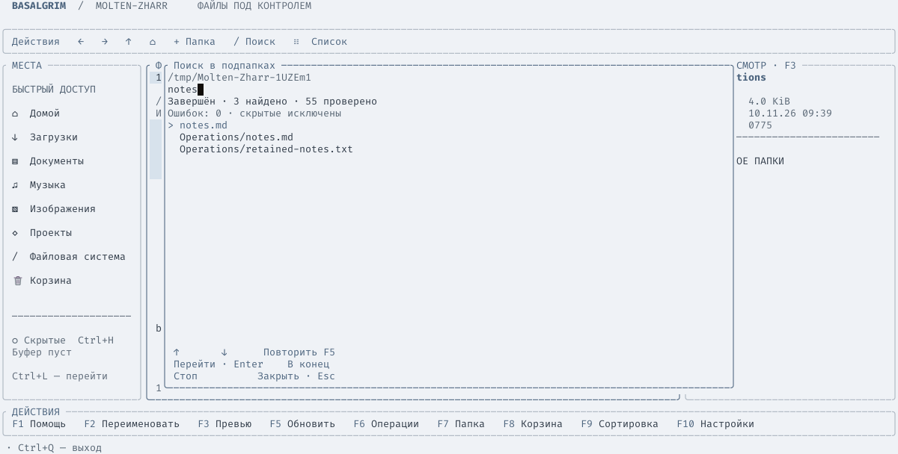


## Видео и миниатюры содержимого

При выборе видео панель предпросмотра показывает статичный кадр, разрешение и длительность. Кадр берётся на 10% длительности, не дальше пятой секунды; если длительность неизвестна — с начала. Enter по-прежнему открывает файл внешним приложением. Поддерживаются MP4/MOV/M4V/3GP, MKV/WebM, AVI, MPEG, M2TS, OGV и FLV, если нужный кодек есть в установленном FFmpeg.

Для видео нужны **ffmpeg** и **ffprobe** в PATH с поддержкой протокола `fd` (проверено с FFmpeg 6.1.1). Их отсутствие, повреждение файла или превышение лимитов показываются в панели. В терминале без графики остаются сведения о видео.

Миниатюры изображений и видео включены по умолчанию. Переключатель: **F10 → Темы → Иконки → Миниатюры файлов**. Они появляются в сетке и списке при режиме иконок **Изображения** и доступной графике GUI/Kitty/Sixel/iTerm2. Настройка **Символы** и отключение миниатюр не выключают картинку в панели предпросмотра. До готовности миниатюры и при ошибке остаётся обычная иконка.

В фоне готовятся только видимые миниатюры: до 128 кадров по 160×160 в памяти (до 12,5 МиБ), без постоянного дискового кэша. Обновление папки меняет поколение запросов; смена видимой области или скрытие отменяют ненужную работу. На очень большом экране остальные файлы показываются обычными иконками. Изображения используют прежние ограничения декодирования; у видео предел 16 мегапикселей, подготовленный кадр до 768×768, до 3 с на чтение сведений и 4 с на кадр. Процесс FFmpeg ограничен 768 МиБ адресного пространства и завершается при отмене. Передаётся открытый обычный файл через дескриптор; сетевые протоколы и внешние файлы не разрешены ([протоколы FFmpeg](https://ffmpeg.org/ffmpeg-protocols.html)).

Проверки: `scripts/smoke_media.py target/release/basalgrim-tui` проверяет цвета переданных кадров и миниатюр в Kitty/Sixel/iTerm2, отсутствие графики, список/сетку, обновление и размер 34×14. Режим `--media-only` у `smoke_gui.py` и `smoke_gui_wayland.py` проверяет реальные пиксели, настройку мышью, смену файла и обновление видео в приватных дисплеях.

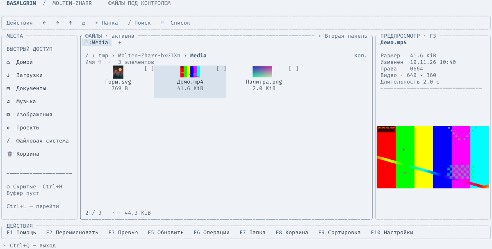

## Подсветка кода

Выберите исходный файл и включите предпросмотр кнопкой **F3 Превью** или клавишей F3. Язык определяется автоматически по имени, расширению или первой строке скрипта и указывается над текстом. Поддерживаются, в частности, Rust, Python, C/C++, JavaScript/TypeScript, shell, JSON, YAML, TOML, HTML и CSS. Колесо над предпросмотром прокручивает код, сохраняя выбор файла.

Ключевые слова, строки, числа, имена и комментарии используют цвета текущей темы, включая пользовательские изменения палитры. Подсветка работает и в обычном терминале без протокола изображений, независимо от выбора символьных иконок. Смена темы применяется сразу; внешняя правка файла обновляет предпросмотр автоматически.

Разбор выполняется в фоновом работнике через [Syntect](https://docs.rs/syntect/5.3.0/syntect/) и встроенные [описания языков two-face](https://docs.rs/two-face/0.5.2/two_face/). Сохраняются лимиты 64 KiB и 300 строк; дополнительно ограничены длина разбираемой строки (2048 байт), число цветных фрагментов (16384) и бюджет разбора (500 мс, проверяется между строками). После достижения границы оставшийся текст показывается без подсветки и появляется пометка «Подсветка ограничена». Неизвестные форматы остаются обычным текстом. Внешние команды и пользовательские описания языков не загружаются.

Лицензии встроенных описаний языков находятся в [assets/licenses/syntaxes.md](../assets/licenses/syntaxes.md). После обновления two-face их можно получить командой `python3 scripts/cargo_local.py run --example syntax_licenses`.

`scripts/smoke_syntax.py target/release/basalgrim-tui` проверяет реальные цвета SGR, мышь, внешнее обновление, F3 и изменение размера через 34×14. Режим `--syntax-only` у оконных smoke-сценариев проверяет пиксели кода в приватных X11/Wayland.

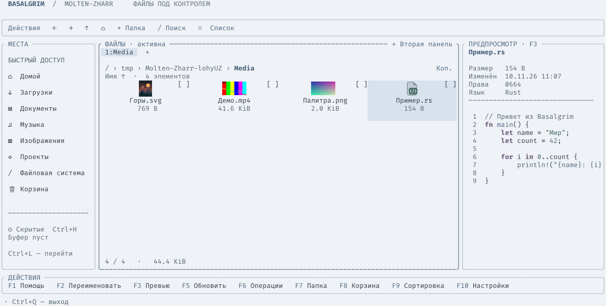

## Размер папки

Нажмите ПКМ на папке → **Размер папки** или кнопку **Размер папки…** в её предпросмотре. ПКМ на свободном месте → **Размер папки** считает текущий каталог. С клавиатуры — **Shift+F4**. Команда работает и при скрытом предпросмотре, в том числе в окне 34×14.

Подсчёт идёт в фоне и показывает накопленный размер файлов, выделенное место на диске, количество файлов, подпапок и ссылок. **Стоп** или пробел сохраняет частичный результат; **Пересчитать** / F5 начинает новый обход. Закрытие кнопкой или Esc останавливает незавершённый подсчёт. Стрелки и колесо прокручивают подробности и ошибки в маленьком окне.

Скрытые файлы включены независимо от фильтра панели. Символические ссылки не обходятся, специальные файлы не читаются. Данные жёстких ссылок считаются один раз по устройству и inode, но количество файлов включает все имена. «Размер файлов» — сумма логических размеров обычных файлов; «На диске» — выделенные блоки, включая каталоги и сами ссылки. Поэтому разреженный файл может иметь большой логический размер и занимать мало места. Вложенные файловые системы обходятся, повторные каталоги не обходятся повторно.

Результат — снимок на время обхода. При недоступных или изменившихся каталогах он помечен как неполный, с числом пропусков и примерами причин. Временная очередь обхода и набор уже учтённых inode хранятся в SQLite на диске с кэшем 1 MiB; лимита общего числа файлов, глубины или суммарной длины путей нет. Каталоги открываются относительно дескрипторов без перехода по ссылкам, включая пути длиннее PATH_MAX.

В памяти сохраняются до 64 успешных результатов на 30 секунд. Повторное открытие проверяет идентичность и метаданные корневой папки в работнике и явно показывает **«Кэш · предыдущий подсчёт»**. Известные изменения открытых каталогов, обновление F5 и файловые операции сбрасывают соответствующий кэш. Вложенные изменения за пределами отслеживаемых каталогов отражаются при новом подсчёте; **Пересчитать** всегда обходит кэш. При закрытии программы кэш исчезает.

Проверки: `tests/folder_sizes.rs` и тесты `folder_size::tests`, `scripts/smoke_folder_size.py target/release/basalgrim-tui`; для нативных X11/Wayland — `--folder-size-only` у оконных smoke-сценариев. Проверяются точные числа, более 250 тысяч файлов, глубокие и длинные пути, ссылки, отмена, сбои временной БД, кэш и мышь в компактном интерфейсе.

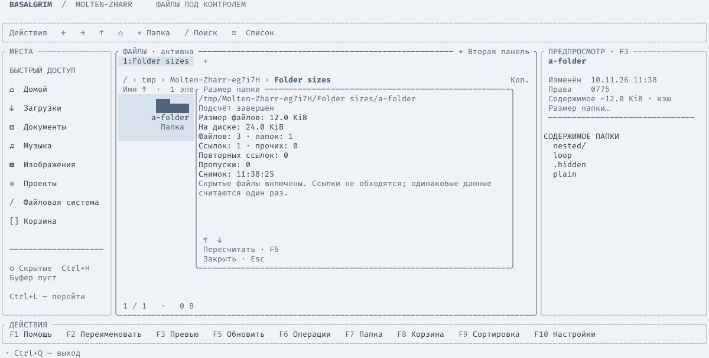

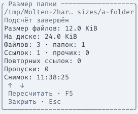


## Встроенный терминал

**F4** или **Действия → Терминал** открывает оболочку в текущей папке. В обычном окне терминал занимает нижнюю часть; **Экран** разворачивает его, **Панель** возвращает назад. В маленьком окне он занимает весь экран. Щелчок по файлам возвращает им клавиатуру; щелчок по терминалу — оболочке. F4 возвращает фокус открытому терминалу, а при повторном нажатии скрывает его.

Внутри работают обычные команды оболочки: **Tab** дополняет ввод, стрелки перемещают курсор и перебирают команды, **Ctrl+C** прерывает активную программу, **Ctrl+D** завершает оболочку. Файловые сочетания вроде Ctrl+C/X/V/Z здесь передаются терминалу. Назначение F4 можно изменить в настройках.

- **Вставить пути** добавляет абсолютные пути выбранных файлов с экранированием пробелов и кавычек. Если файловый выбор пуст, вставляется путь текущей папки. Enter не нажимается автоматически. Имена с управляющими символами отклоняются.
- **Вставить**, **Ctrl+Shift+V** или **Shift+Insert** вставляют текст из системного буфера, если он доступен. В обычном TUI можно пользоваться вставкой самого внешнего терминала. Многострочный текст передаётся в bracketed-paste; если программа этот режим не включила, переводы строк заменяются пробелами.
- Выделите текст ЛКМ и нажмите **Копировать** или **Ctrl+Shift+C**. Выделенный экран остаётся неподвижным до следующего ввода, прокрутки или щелчка; вывод программы продолжает читаться в фоне. Файловый буфер сохраняется.
- Колесо, **↑ / ↓** и **Shift+PageUp/PageDown** прокручивают историю до 2000 строк. **Вниз** или **Shift+End** возвращают к вводу. Если программа включила терминальный протокол мыши, щелчки, движения и колесо передаются ей; удерживайте Shift для обычного выделения и прокрутки истории.
- **Скрыть** оставляет оболочку и её команды работать. **×** просит подтвердить завершение оболочки и активной команды. После `exit`, Ctrl+D или другого завершения оболочки панель закрывается автоматически. Следующий F4 запускает новую оболочку в текущей папке файловой панели. Ошибка запуска остаётся видимой, чтобы её можно было прочитать и повторить запуск.

Повторное открытие возвращает тот же сеанс, даже если файловая панель уже перешла в другой каталог. Строка **Старт:** показывает папку запуска, а текущую папку оболочки можно узнать командой `pwd`. Для нового сеанса в другой папке завершите прежний и нажмите **F4**. При закрытии Basalgrim сеанс завершается; после перезапуска приложения он не восстанавливается.

Используется `$SHELL -i`, а при отсутствующем абсолютном пути в `$SHELL` — `/bin/sh -i`. PTY, VT-парсер, чтение и запись работают в отдельном потоке с ограниченными очередями. Поддерживаются ANSI/256/RGB-цвета, Unicode, курсор, основной и альтернативный экран, изменение размера и mouse reporting. Изображения, OSC 52 и изменение заголовка внешнего окна из вывода команд не исполняются. Сужение экрана обрезает старые длинные строки по ширине; переноса старой истории заново нет.

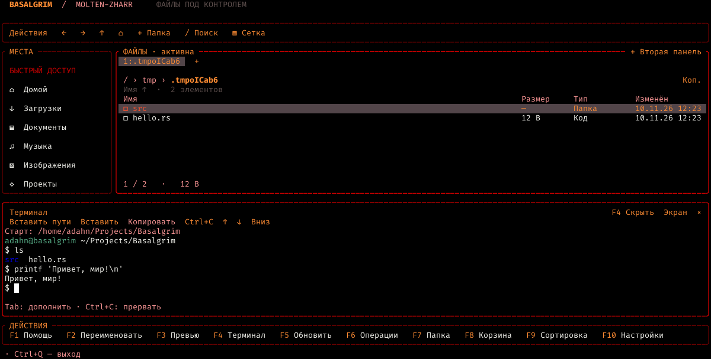

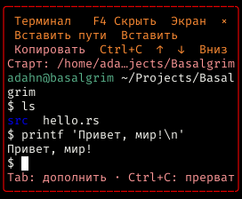

`python3 scripts/smoke_terminal.py target/release/basalgrim-tui` проверяет настоящий вложенный PTY: папку запуска, текст, Tab, Ctrl+C, кавычки в путях, цвета, альтернативный экран, мышь приложения, историю, скрытие, изменение размера и завершение. `--terminal-only` у `smoke_gui.py` и `smoke_gui_wayland.py` проверяет те же основные сценарии на частных дисплеях, включая текстовый буфер и реальные пиксели VT-экрана. Эталон: `python3 scripts/cargo_local.py run --example terminal_preview --all-features` (PNG в `target/preview/`). README сохраняет общий обзор интерфейса.
